<h1 align="center">
  
</h1>

<p align="center"><strong>See what every device on your network is doing.</strong></p>

<p align="center">
  <a href="LICENSE"></a>
  
  <a href="https://github.com/EliasMarine/NetTap/actions/workflows/ci.yml"></a>
  <a href="https://eliasmarine.github.io/NetTap/"></a>
</p>

<p align="center">
  <a href="https://eliasmarine.github.io/NetTap/getting-started/setup-guide/#3-install-ubuntu-server"></a>
  
  <a href="docker/docker-compose.yml"></a>
  <a href="daemon/"></a>
  <a href="web/"></a>
</p>

<p align="center">
  <a href="https://github.com/cisagov/Malcolm"></a>
  <a href="https://zeek.org"></a>
  <a href="https://suricata.io"></a>
  <a href="https://opensearch.org"></a>
</p>

<p align="center">
  <a href="https://eliasmarine.github.io/NetTap/"></a>
  <br>
  <sub>A short tour (demo data). Click to watch the full-quality video on the docs site.</sub>
</p>

NetTap is a self-hosted network monitor for homes and small businesses. Put it on a small x86 box on your network and it records the traffic, flags threats and shows it all in a web dashboard. It runs CISA's [Malcolm](https://github.com/cisagov/Malcolm) stack (Zeek, Suricata, OpenSearch) and adds an installer, a setup wizard, its own dashboard and automatic storage management.

> **Pre-release.** No version has been tagged yet. It runs on test hardware, but expect rough edges.

**New here?** The [setup guide](docs/getting-started/setup-guide.md) walks you through everything from choosing hardware to a dashboard full of live data.

## What you get

- **Devices**: every device on the network, with its traffic, alerts and a risk score
- **Alerts**: Suricata intrusion detection (Emerging Threats Open rules) explained in plain English, plus behaviour checks such as beaconing and DNS anomalies
- **Traffic**: connections, DNS, TLS certificates, GeoIP and bandwidth per device
- **Packet capture**: full PCAP you can search and download, with TShark and CyberChef built in
- **Notifications**: email, Discord, Slack, Telegram, Pushover or a webhook
- **Low upkeep**: deletes old data before the disk fills, watches SSD health, and updates Malcolm with a backup and rollback
- **Local only**: no cloud, no account, no subscription. Your traffic stays on the box. Update checks, rule downloads and WHOIS lookups do use the internet.

## Screenshots

<table>
  <tr>
    <td colspan="2"><a href="docs/assets/media/live-globe-expanded.png">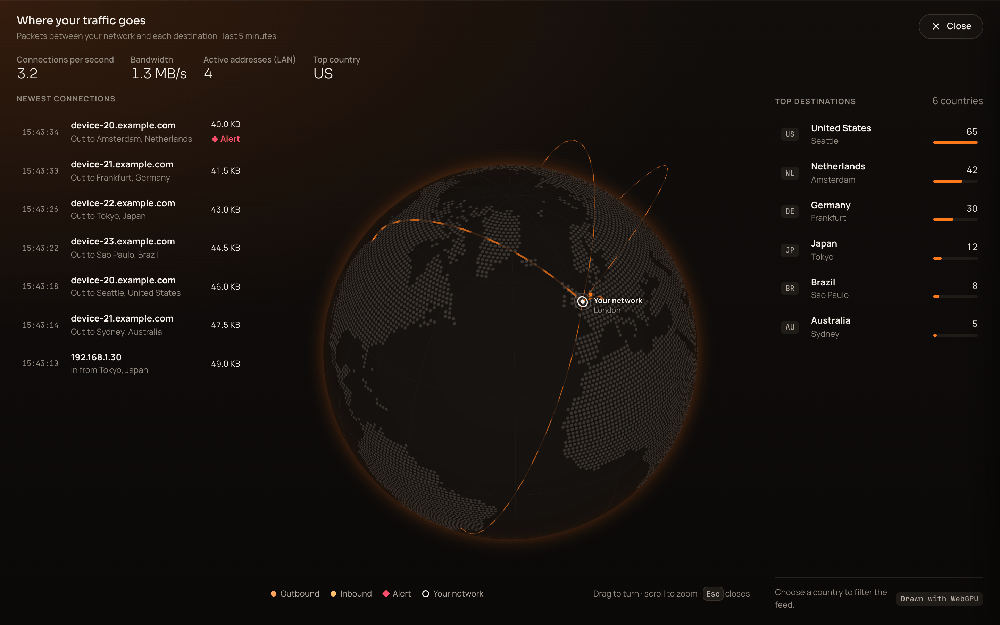</a><br><sub>Live monitor, expanded: the globe with the newest connections and top destinations</sub></td>
  </tr>
  <tr>
    <td width="50%"><a href="docs/assets/media/home.png">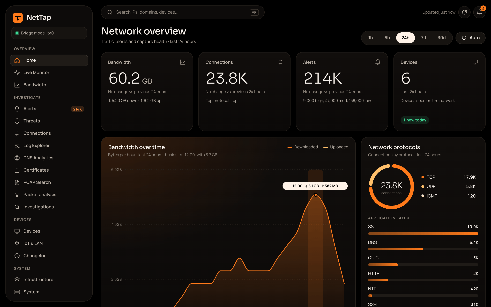</a><br><sub>Home: traffic, alerts and devices at a glance</sub></td>
    <td width="50%"><a href="docs/assets/media/live-globe.png">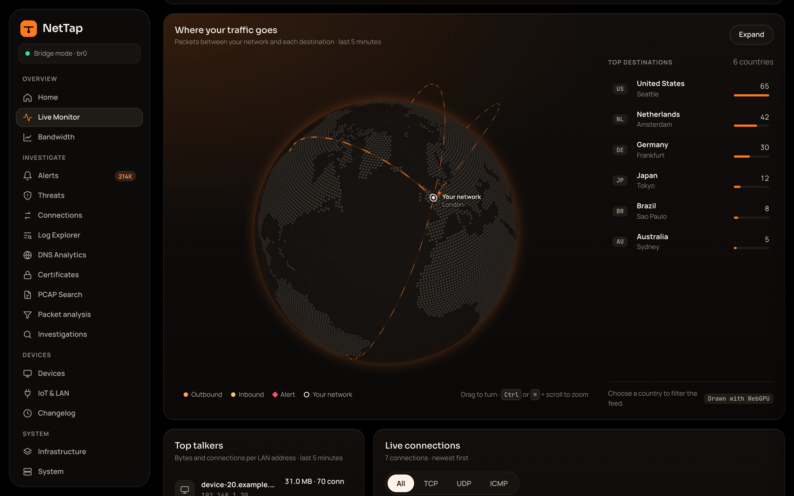</a><br><sub>Live monitor: where your traffic goes, on a 3D globe</sub></td>
  </tr>
  <tr>
    <td width="50%"><a href="docs/assets/media/alerts.png">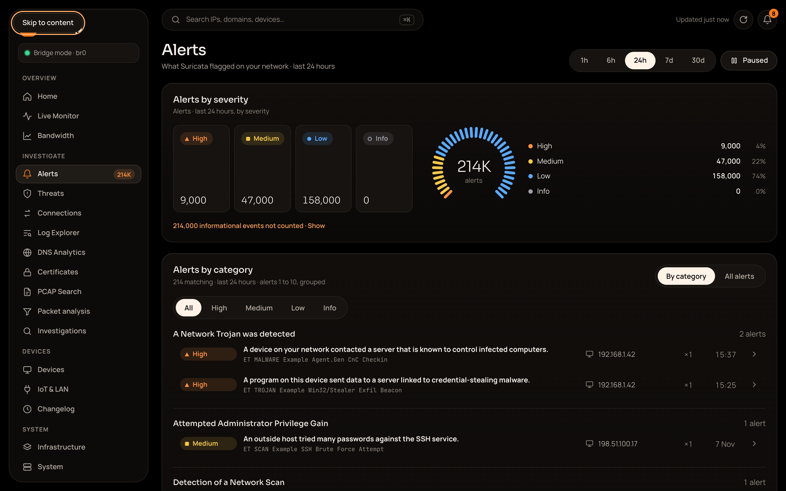</a><br><sub>Alerts: Suricata detections explained in plain English</sub></td>
    <td width="50%"><a href="docs/assets/media/alert-category.png">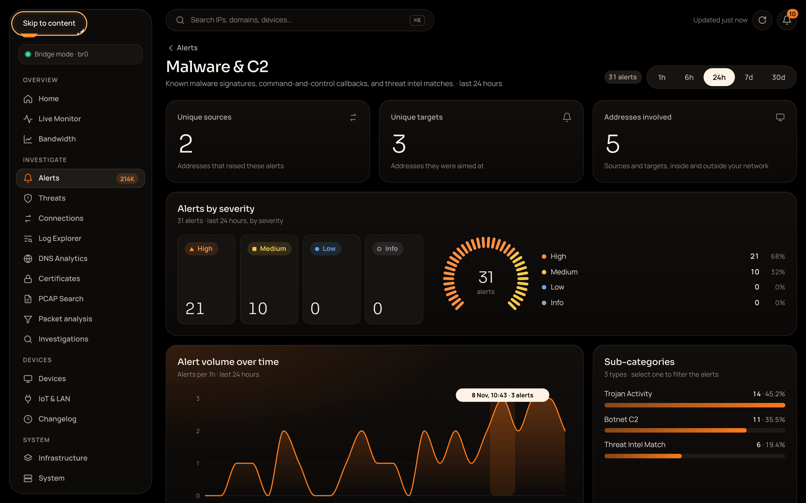</a><br><sub>One alert category: its sources, targets and timeline</sub></td>
  </tr>
  <tr>
    <td width="50%"><a href="docs/assets/media/packets.png">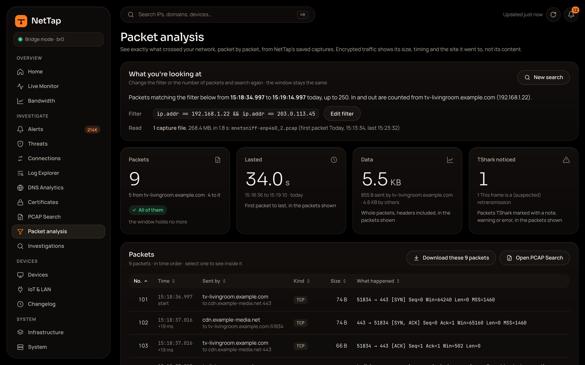</a><br><sub>Packet analysis: a conversation, packet by packet</sub></td>
    <td width="50%"><a href="docs/assets/media/packet-detail.png">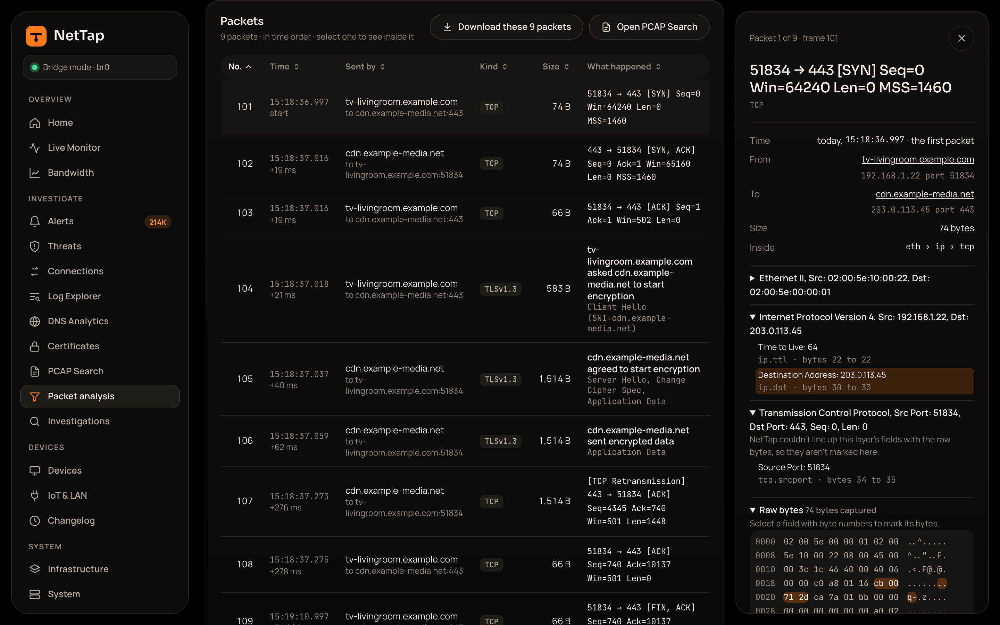</a><br><sub>One packet: its decoded layers and raw bytes</sub></td>
  </tr>
  <tr>
    <td width="50%"><a href="docs/assets/media/devices.png">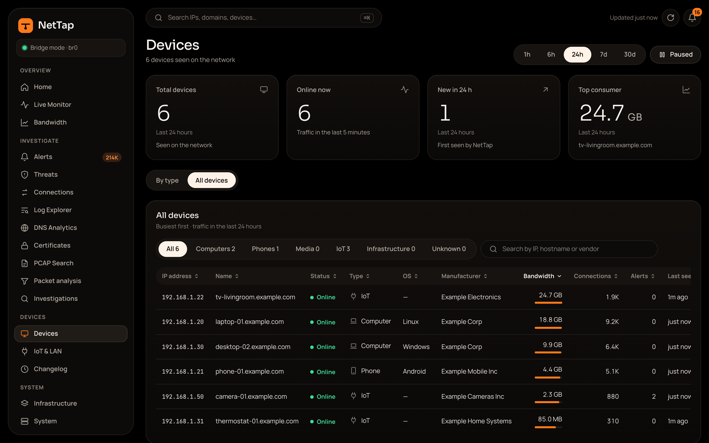</a><br><sub>Devices: every device, what it is and how much it uses</sub></td>
    <td width="50%"><a href="docs/assets/media/device-detail.png">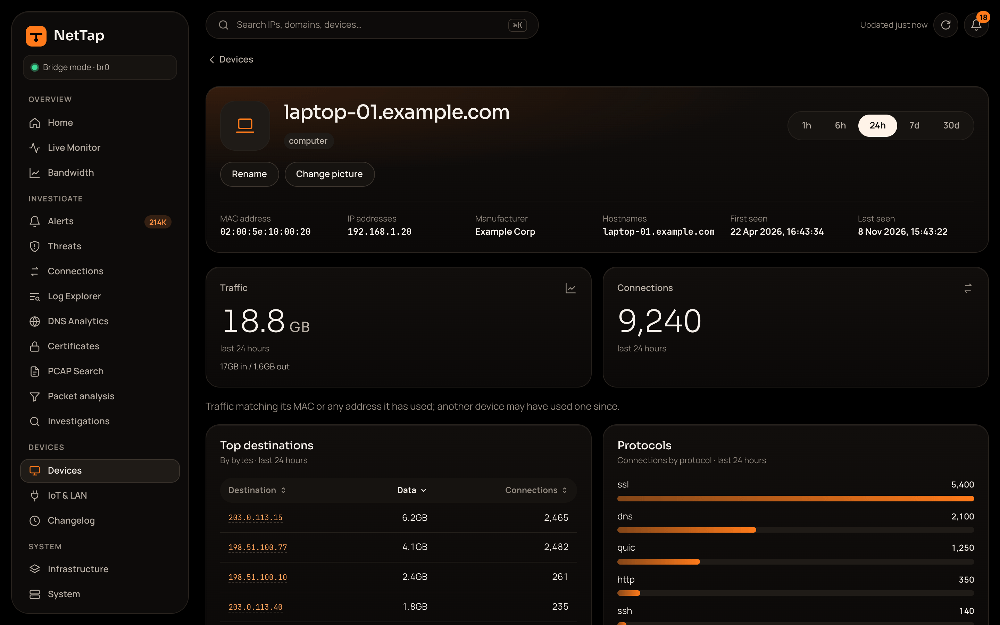</a><br><sub>One device: its traffic, destinations and protocols</sub></td>
  </tr>
  <tr>
    <td width="50%"><a href="docs/assets/media/threats.png">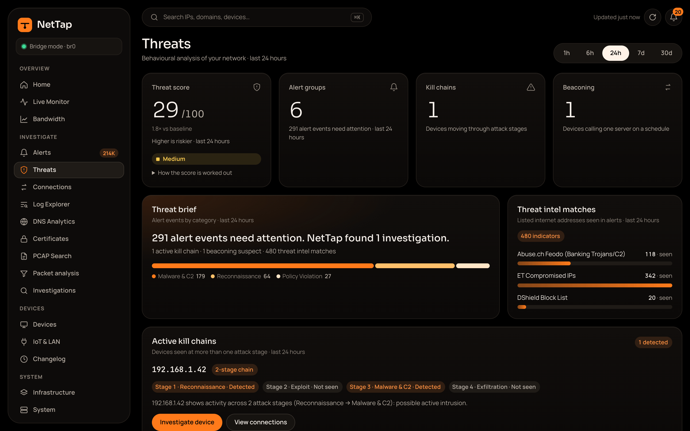</a><br><sub>Threats: threat score, kill chains and threat-intel matches</sub></td>
    <td width="50%"><a href="docs/assets/media/certificates.png">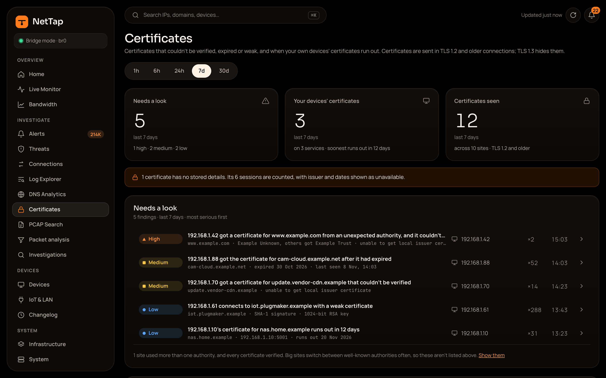</a><br><sub>Certificates: TLS certificates that need a look</sub></td>
  </tr>
</table>

The screenshots and the tour use demo data, not a real network. To make them again after a UI change, run `cd web && npm run capture:media` (needs ffmpeg).

## How it connects

You pick a mode in the setup wizard. It can't be changed after setup yet.

- **DHCP gateway** (recommended, 1 NIC). NetTap hands out addresses and routes traffic on to your router, so it sees each device's own IP. You turn off the router's DHCP. Devices with a static IP, IPv6 and device-to-device traffic bypass it, router port forwards stop working, and devices lose internet if NetTap goes down. Not yet tested on real hardware.
- **Mirror / SPAN** (1 capture NIC). A managed switch copies traffic to NetTap. NetTap is outside the traffic path, so it can't break your network.
- **Inline bridge** (advanced, 2 NICs). NetTap sits between the modem and the router. It sees all internet traffic, but after the router's NAT, so every device shows up as the router's IP. The kernel bridge keeps forwarding if NetTap's services stop.

Mirror and bridge modes also need a management interface (a spare NIC or Wi-Fi) for the dashboard.

## Requirements

- An x86-64 box running Ubuntu Server 22.04 or 24.04 (ARM is not supported)
- 8 GB RAM and a 512 GB SSD at minimum; 16 GB and a 1 TB NVMe recommended, for example an Intel N100 mini PC
- At least 2 physical Ethernet ports. The installer needs them even if you then choose a one-NIC mode.

See the [hardware guide](docs/getting-started/hardware-guide.md).

## Install

```bash
git clone https://github.com/EliasMarine/NetTap.git
cd NetTap
sudo scripts/install/install.sh
```

The installer blinks each port's LED so you can tell them apart and asks which is which. It then installs Docker, sets up the bridge (`--skip-bridge` skips it), starts the pinned Malcolm images and NetTap's services, and prints a wiring diagram. `--help` lists every option.

Then open **https://nettap.local** from a device on your network. NetTap makes its own TLS certificate, so your browser warns you the first time. The setup wizard asks for the capture mode, ports, retention and an admin account.

## Storage

Zeek and Suricata records are kept for 90 days. Packet captures are kept for 30 days and use at most 25% of the disk. The daemon checks the disk every 5 minutes:

- **80% full**: deletes data past its retention
- **90% full**: deletes the oldest captures, then the oldest records
- **95% full**: also pauses packet capture until usage drops below 85%

Retention can be changed in Settings.

## Development

The daemon is Python (aiohttp) and the web UI is SvelteKit (Svelte 5). From the repo root:

```bash
cd daemon && python3 -m pytest -q
cd web && npx vitest run && npx svelte-check
```

See the [developer guide](docs/developer-guide/dev-setup.md) and the [full docs](docs/index.md).

## Roadmap

- [x] Core infrastructure, storage management and onboarding
- [ ] Dashboard polish (built, being tested on hardware)
- [ ] DHCP gateway mode tested on hardware, and changing capture mode after setup
- [ ] v1.0 community release

## Contributing

Bug reports and feature requests are welcome in the issue tracker. Read [CONTRIBUTING.md](CONTRIBUTING.md) before opening a pull request.

## License

[NetTap Personal Use License](LICENSE): free for personal, non-commercial use. Commercial use, modification and redistribution need written permission. Malcolm, Zeek, Suricata, OpenSearch and the other third-party parts keep their own licences; see [THIRD-PARTY-LICENSES.md](THIRD-PARTY-LICENSES.md).
