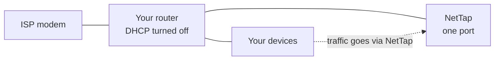
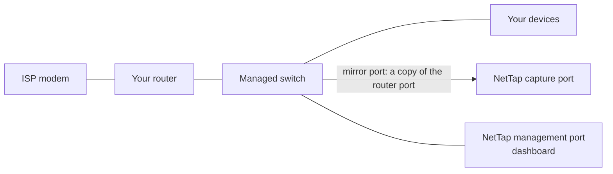
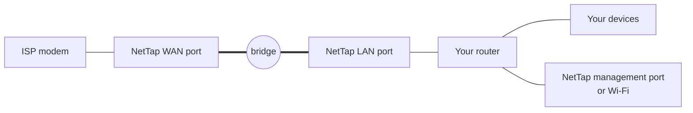

# Setup guide

This guide takes you from a new mini PC to a NetTap dashboard full of live data. It covers every step in order: picking hardware, choosing how NetTap joins your network, installing Ubuntu, running the installer and the setup wizard, and checking it all works. It finishes with updating, troubleshooting and removing NetTap.

You don't need to be a networking expert. You do need to be happy typing commands into a terminal and plugging cables into a router.

> **Pre-release.** NetTap hasn't had a tagged release yet. It runs well on the test hardware listed below, but expect rough edges, and keep a way to put your network back the way it was (see [section 12](#12-take-nettap-out-of-your-network)).

**Contents**

1. [Before you start](#1-before-you-start)
2. [Choose how NetTap connects](#2-choose-how-nettap-connects)
3. [Install Ubuntu Server](#3-install-ubuntu-server)
4. [Get NetTap](#4-get-nettap)
5. [Run the installer](#5-run-the-installer)
6. [Run the setup wizard](#6-run-the-setup-wizard)
7. [Go live](#7-go-live)
8. [Check it works](#8-check-it-works)
9. [Find your way around](#9-find-your-way-around)
10. [Keep NetTap up to date](#10-keep-nettap-up-to-date)
11. [Troubleshooting](#11-troubleshooting)
12. [Take NetTap out of your network](#12-take-nettap-out-of-your-network)
13. [FAQ](#13-faq)
14. [Going deeper](#14-going-deeper)

---

## 1. Before you start

### What you'll end up with

A small box on your network that records who talks to whom, flags threats with Suricata, keeps packet captures you can search, and shows it all at `https://nettap.local`. Everything stays on the box: no cloud account, no subscription.

### Hardware

| | Minimum | Recommended |
|---|---|---|
| CPU | x86-64, 2 cores | 4 cores, for example an Intel N100 |
| RAM | 8 GB | 16 GB |
| Disk | 512 GB SSD | 1 TB NVMe SSD |
| Network ports | 2 wired Ethernet ports | 2 × 2.5 GbE ports, plus a third port or Wi-Fi for the dashboard |

The installer stops if the box isn't x86-64, has fewer than 2 CPU cores, less than 8 GB of RAM or fewer than 2 network ports (Wi-Fi counts as one). It warns, but carries on, below 4 cores, 16 GB of RAM or about 400 GB of disk. ARM boards such as the Raspberry Pi aren't supported.

The installer checks for two ports even if you then pick a mode that uses only one.

### Hardware that has been tested

| Box | Network chips | Ubuntu | Mode tested |
|---|---|---|---|
| Intel N100 mini PC, 16 GB, 1 TB NVMe | 2 × Intel i226-V 2.5 GbE | 22.04 LTS | Inline bridge (March 2026) |
| GMKtec G11 (AMD Ryzen Embedded R2514) | 2 × Realtek RTL8125BG 2.5 GbE | 24.04.5 LTS | Mirror / SPAN (November 2026 onwards) |

Other x86-64 boxes that meet the minimums should work. See the [hardware guide](hardware-guide.md) for buying advice.

### You'll also need

- A USB stick (4 GB or more) to install Ubuntu.
- A monitor and keyboard for the Ubuntu install. After that you can use SSH from another computer.
- Ethernet cables: one or two more than you use today, depending on the mode.
- Internet access during the install. NetTap downloads about 10 to 15 GB of container images.
- For mirror mode only: a managed switch that can mirror a port (often called SPAN or port mirroring).

### How long it takes

Allow about an hour from start to finish. The NetTap installer itself takes 10 to 20 minutes, most of it downloading, and the first data appears a few minutes after setup.

---

## 2. Choose how NetTap connects

Decide this first. It changes how you cable the box and how you run the installer, and **it can't be changed in the app after setup yet**.

| | DHCP gateway | Mirror / SPAN | Inline bridge |
|---|---|---|---|
| Network ports used | 1 | 1 for capture, plus 1 for the dashboard | 2 for the bridge, plus a 3rd port or Wi-Fi for the dashboard |
| Extra hardware | None | Managed switch with port mirroring | None |
| Sees each device's own IP | Yes | Yes | No, every device shows as your router's IP |
| If NetTap stops or loses power | Devices lose internet until you turn your router's DHCP back on | Nothing happens to your network | The bridge keeps forwarding if NetTap's services stop. A power cut or reboot drops the internet until the box is back up |
| Tested on real hardware | **Not yet** | Yes | Yes |
| Install command | `--skip-bridge` | `--skip-bridge` | Default |

**Which one?**

- **You have a managed switch:** pick **mirror**. It can't break your network, and it sees every device.
- **You don't, and you want per-device detail:** **DHCP gateway** is the mode the wizard marks as recommended, but it hasn't been tested on real hardware yet. Read its limits below before you choose it.
- **You want to see all internet traffic and have three ports (or two ports and Wi-Fi):** pick **inline bridge**. Devices behind your router all show up as the router's address.

### DHCP gateway

NetTap plugs into your router with one cable. It hands out addresses to your devices and passes their traffic on to the router, so it sees each device. You turn off your router's DHCP server as part of going live.



Know these limits before you choose it:

- **Double NAT.** Port forwards and UPnP on your router stop reaching your devices, and game consoles may report a strict NAT type.
- **IPv6 skips NetTap.** If your router hands out IPv6 addresses, that traffic goes straight to the router. Turn IPv6 off on the router for full visibility.
- **Static IPs are invisible.** Devices with a manually set IP address never use NetTap.
- **NetTap must stay on.** If it's off, devices that got their address from NetTap lose internet until you turn the router's DHCP back on.

### Mirror / SPAN

Your managed switch sends NetTap a copy of the traffic on the port that connects the switch to your router. NetTap is outside the traffic path.



The capture port gets no IP address. You reach the dashboard through the second port, which plugs into an ordinary switch port.

### Inline bridge

NetTap sits between your modem and your router. The two bridge ports have no IP addresses. A third port, or Wi-Fi, gives you the dashboard.



Wi-Fi can be the management interface, but it can't be part of the bridge.

---

## 3. Install Ubuntu Server

NetTap runs on **Ubuntu Server 24.04 LTS** or **22.04 LTS**. Current testing is on 24.04. Follow Ubuntu's own [server install tutorial](https://ubuntu.com/tutorials/install-ubuntu-server). Only the choices below matter for NetTap.

**Before you start the Ubuntu installer, plug in only one network cable:**

| Mode | Plug in |
|---|---|
| DHCP gateway | The port that will connect to your router, plugged into your router |
| Mirror / SPAN | The port you'll use for the dashboard, plugged into an ordinary port on your switch or router |
| Inline bridge | The port you'll use for the dashboard, plugged into your router. Or skip the cable and set up Wi-Fi in the installer |

Leave the other ports unplugged for now. You'll connect them in [section 6](#6-run-the-setup-wizard) or [section 7](#7-go-live).

**In the Ubuntu installer:**

1. **Installation type:** choose **Ubuntu Server**, not **Ubuntu Server (minimized)**.
2. **Network:** let the plugged-in port get its address automatically (DHCP).
3. **Storage:** use the entire disk. Ubuntu's default LVM layout can leave much of a large disk unused, so on the summary screen check the size of `ubuntu-lv`. If it's smaller than the disk, edit it to the maximum size.
4. **Profile:** use `nettap` as **your username**. NetTap's helper scripts expect the code at `/home/nettap/NetTap`. The server name doesn't matter, because the installer renames the box to `nettap`.
5. **SSH:** tick **Install OpenSSH server**, so you can work from another computer.
6. **Featured server snaps:** don't tick anything, **especially not Docker**. The NetTap installer installs Docker itself, and the snap version gets in its way.

When Ubuntu has rebooted, sign in as `nettap` (on the box or with `ssh nettap@<the box's IP>`) and bring it up to date:

```bash
sudo apt update
```

```bash
sudo apt upgrade -y
```

Check that the root filesystem has most of your disk:

```bash
df -h /
```

<details markdown="1">
<summary>The size is much smaller than your disk</summary>

Grow the default Ubuntu volume to fill the disk. This only works with Ubuntu's default LVM layout:

```bash
sudo lvextend -r -l +100%FREE /dev/ubuntu-vg/ubuntu-lv
```

Then run `df -h /` again.

</details>

### Tell your ports apart

Ubuntu names ports things like `enp1s0` and `enp2s0`. To see which name belongs to which socket, list them, plug a cable into one socket, and list them again:

```bash
ip -br link
```

The port you just plugged in changes from `DOWN` to `UP`. Write down which name is which. You'll need them in the installer and the wizard. The installer can also blink a port's light for you, though that doesn't work on every network chip.

---

## 4. Get NetTap

Ubuntu Server comes with `git`. Download NetTap into your home folder:

```bash
cd ~
```

```bash
git clone https://github.com/EliasMarine/NetTap.git
```

```bash
cd ~/NetTap
```

Every command from here on runs from `~/NetTap` (which is `/home/nettap/NetTap`) unless it says otherwise.

> **Don't copy `.env.example` to `.env`.** The installer would then skip asking which port is which, and use the example's placeholder port names. Let the installer create `.env`, except in the one bridge-mode case in [section 5](#5-run-the-installer).

---

## 5. Run the installer

### Pick the right command

| Mode | Command |
|---|---|
| Inline bridge | `sudo scripts/install/install.sh` |
| Mirror / SPAN | `sudo scripts/install/install.sh --skip-bridge` |
| DHCP gateway | `sudo scripts/install/install.sh --skip-bridge` |

**Why `--skip-bridge` matters:** by default the installer joins two ports into a bridge, and a port in the bridge loses its IP address. In mirror and DHCP gateway modes that would take ports you need for something else. On a two-port box it always takes your management or router port, and with it your SSH session and the box's internet, partway through the download.

**Bridge mode:** the box must reach the internet through its management port or Wi-Fi during the install, never through the ports that become WAN or LAN. The bridge is built in step 4, before the downloads in step 5.

**Bridge mode with a wired management port: one extra step first.** The installer starts `.env` from `.env.example`, which gives the management port a fixed extra address, `192.168.1.100`. That can clash with another device on your network. Start `.env` without the example's network lines instead:

```bash
grep -v -E '^(MGMT_|WAN_|LAN_)' .env.example > .env
```

The installer still asks about every port. Skip this step in mirror and DHCP gateway modes, and if you use Wi-Fi for management.

Run the command for your mode, for example:

```bash
sudo scripts/install/install.sh
```

### Answer the port questions

First the installer lists your network ports. The one carrying your internet connection is marked `<-- current internet`. It offers to blink a port's light so you can find it.

- **Three or more ports:** it asks for the **MANAGEMENT** port (dashboard access), then **WAN** (modem side), then **LAN** (router side). In bridge mode, choose the port marked `<-- current internet` (or your Wi-Fi) as MANAGEMENT. Never pick Wi-Fi as WAN or LAN.
- **Exactly two ports:** it asks only for WAN and assigns LAN itself. It warns that there's no dedicated management port.
- **Mirror and DHCP gateway modes:** these answers don't matter, because `--skip-bridge` means nothing is bridged. You pick the real ports in the setup wizard.

If you chose the internet port as WAN or LAN, it warns: "Internet will be unavailable until cables are rewired and bridge is activated." In bridge mode, press Ctrl-C and start again with the right ports.

### Let it run

The installer then shows a "Before we start" card and counts down from 5 seconds (Enter starts at once, Ctrl-C cancels). It works through nine steps:

| Step | What happens |
|---|---|
| `[1/9] Pre-flight checks` | Checks Ubuntu, CPU, RAM, disk and ports |
| `[2/9] Installing system dependencies` | Installs Docker, Compose, ethtool, smartmontools, Avahi and other packages |
| `[3/9] Applying kernel tuning` | Sets the kernel values OpenSearch and packet capture need |
| `[4/9] Configuring network bridge` | Builds the bridge `br0` (skipped with `--skip-bridge`) |
| `[5/9] Deploying Malcolm stack` | Downloads the pinned Malcolm 26.10.0 images, builds NetTap's own images, generates passwords and certificates, starts everything |
| `[6/9] Installing systemd services` | Installs `nettap.service` so NetTap starts on boot |
| `[7/9] Configuring mDNS (nettap.local)` | Renames the box `nettap` and publishes `nettap.local` on your network |
| `[8/9] Configuring firewall rules` | Opens the dashboard and mDNS ports in UFW, if UFW is installed |
| `[9/9] Running post-install verification` | Checks the bridge, Docker, the containers, OpenSearch, mDNS and the boot service |

Step 5 is the long one. It can sit for several minutes while OpenSearch and Logstash start. With `--skip-bridge` it may list the capture containers (`zeek-live`, `suricata-live`, `pcap-capture`) under "Some services are not healthy", because they don't know which port to capture on until you finish the wizard.

### What you should see

A summary card that starts **NetTap is installed** and shows the dashboard address, `https://nettap.local`. In bridge mode it also tells you to move the cables. You can, but it's easier to wait: the [Go live](#7-go-live) page walks you through it and keeps your internet up for longer.

With `--skip-bridge` the card still prints bridge cabling steps. Ignore them.

Two things in the output look wrong but aren't:

- **The warning "OpenSearch not responding yet"** in the verification step. The installer's check doesn't sign in to OpenSearch, so it can't tell. [Section 8](#8-check-it-works) has the proper check.
- **The card's "Malcolm https://localhost:9443" line** points at nothing. Malcolm's own dashboards are at `https://nettap.local/dashboards/`, behind the NetTap login.

If a step fails, the installer names it, gives a hint and prints the command to run again. Running the installer again is safe. It keeps the port roles, passwords and certificates it already made. To choose the ports again, add `--reconfigure-nics`.

<details markdown="1">
<summary>All installer options</summary>

| Option | What it does |
|---|---|
| `--skip-bridge` | Don't build the bridge (mirror and DHCP gateway modes) |
| `--defer-bridge` | Don't build the bridge or start NetTap yet. After moving the cables, run `sudo scripts/install/activate-bridge.sh` to do both |
| `--skip-pull` | Use container images already downloaded |
| `--skip-malcolm` | Do everything except download and start NetTap's containers |
| `--no-persist-bridge` | Build the bridge for this boot only |
| `--non-interactive` | Pick ports automatically, no questions |
| `--reconfigure-nics` | Ask about the ports again |
| `--dry-run` | Log the commands instead of running most of them. It still writes some system files, so it isn't a safe preview |
| `-v`, `--verbose` | More detail |

`sudo scripts/install/install.sh --help` prints this list. The [installation reference](installation.md) covers each step in more detail.

</details>

---

## 6. Run the setup wizard

### Cable up first

| Mode | Before you open the wizard |
|---|---|
| DHCP gateway | Nothing to do: the router port is already plugged into your router |
| Mirror / SPAN | On your switch, mirror the port that connects it to your router (both directions) to a spare port. Plug NetTap's capture port into that spare port. Your switch's manual calls this port mirroring or SPAN |
| Inline bridge | Nothing yet. Leave WAN and LAN unplugged until [Go live](#7-go-live) |

### Open the dashboard

On a computer or phone on the same network, open:

```
https://nettap.local
```

If that doesn't load, use the box's IP address instead. Run `hostname -I` on the box to find it.

Your browser warns that the certificate isn't trusted. That's expected: NetTap makes its own certificate. Accept the warning to continue. The [TLS certificates](../admin-guide/tls-certificates.md) page explains how to trust it or use your own.

Until an admin account exists, every page sends you to the setup wizard at `/setup`. Its steps depend on the mode:

| Mode | Steps |
|---|---|
| DHCP gateway | Welcome, Capture mode, Interfaces, DHCP gateway, Storage, Enrichment, Account, Verification |
| Mirror / SPAN | Welcome, Capture mode, Interfaces, Storage, Enrichment, Account, Verification |
| Inline bridge | Welcome, Capture mode, Interfaces, Bridge, Storage, Enrichment, Account, Verification |

Nothing on your network changes until you select **Complete setup** on the Account step. In bridge and DHCP gateway modes, the real switch-over happens later, on [Go live](#7-go-live).

**Welcome.** Checks the network ports, the NetTap service and free disk space (100 GB or more). A failed check doesn't stop you, but fix it before you go on. Select **Get started**.

**Capture mode.** Pick the mode you chose in [section 2](#2-choose-how-nettap-connects): **DHCP gateway**, **Mirror / SPAN**, or **Inline bridge** (under **Advanced**).

**Interfaces.**

- *DHCP gateway:* choose the **router port**, the port plugged into your router. If it warns the port has no IPv4 address, check the cable and select **Refresh interfaces**.
- *Mirror:* choose the **capture interface**, the port plugged into the switch's mirror port. Leave the management interface on **Auto-detect**. The capture port must have no IP address and must not be your internet port. NetTap refuses it otherwise, and changes nothing.
- *Inline bridge:* choose the **WAN interface** (modem side) and **LAN interface** (router side). Use the same ports you gave the installer.

**DHCP gateway** *(DHCP gateway mode only).* Pick the address range NetTap hands out. Keep the default, `10.77.0.0/24`, unless your network already uses it. NetTap takes `10.77.0.1`, keeps `.2` to `.9` free for devices with fixed addresses, and hands out `.10` onwards.

**Bridge** *(bridge mode only).* Shows the planned bridge. Select **Verify configuration**, and don't skip it: it checks the plan without changing anything, and it saves your port choices for the Go Live page. It refuses a port the box still uses for its own connection.

**Storage.** How long NetTap keeps data, and when it starts deleting old data. The defaults suit most homes with a 1 TB disk:

| Setting | Default |
|---|---|
| Hot tier (Zeek records and Suricata alerts) | 90 days |
| Warm tier | 180 days |
| Cold tier (packet captures) | 30 days |
| Warning threshold | 80% disk |
| Emergency threshold | 90% disk |

You can change these later in **Settings › Retention**.

**Enrichment.** If you use UniFi network gear, turn this on and add your controller's URL and an API key so NetTap can name your devices. Otherwise skip it. NetTap still works devices out from their traffic.

**Account.** Create the admin account you'll sign in with:

- Username: at least 3 characters, using letters, numbers, `-` and `_`.
- Password: at least 8 characters, with an uppercase letter, a lowercase letter and a number.

There's one admin account and **no password reset in the app yet**, so keep the password in a password manager. Select **Complete setup**. NetTap creates the account, signs you in and saves your capture settings. In mirror mode it starts capturing straight away.

**Verification.** Checks the NetTap service, OpenSearch, self-traffic exclusion, the bridge (bridge mode) and your UniFi controller (if you added one). A self-traffic warning doesn't stop anything. Then:

- **DHCP gateway** and **inline bridge:** select **Go Live setup**.
- **Mirror:** select **Go to dashboard**. You're done with setup; skip to [section 8](#8-check-it-works). (Don't use Go Live in mirror mode. That page is for the other two modes.)

---

## 7. Go live

Use the same browser you ran the wizard in. In bridge mode, the Go Live page reads the ports that **Verify configuration** saved in that browser. Without them it shows the wrong port names.

### Inline bridge: move the cables

The page has three phases: **Readiness**, **Wiring** and **Monitoring**.

1. **Readiness** checks the bridge and the ports.
2. **Wiring** shows which cable goes where:
   1. Disconnect the cable from your ISP modem to your router.
   2. Connect the modem's cable to NetTap's **WAN** port.
   3. Connect a new cable from NetTap's **LAN** port to your router's WAN (internet) port.
   4. Wait for both ports to read **Connected**. The page moves on by itself.
3. **Monitoring** shows the bridge carrying traffic.

Your internet is down only while you swap the cables. Keep the management port (or Wi-Fi) connected so you keep the dashboard.

### DHCP gateway: switch your devices over

1. **Pre-checks.** The page checks: network port connected, router found, router's DHCP server is off, address range is free, routing allowed, firewall ready, and IPv6 traffic. All but the IPv6 check must pass. The DHCP check fails at first, which is expected.
2. **Turn off your router's DHCP server.**
   1. Open your router's admin page in a browser. The address and password are often on a sticker on the router. If you manage it with a phone app (most mesh systems), use the app.
   2. Find the DHCP server setting, usually under LAN, Network or Advanced.
   3. Turn the DHCP server off and save. Leave everything else as it is.
   4. Come back and select **Check again**.
3. **Turn on the DHCP gateway.** Tick the box that says you understand NetTap becomes your network's gateway, then select **Enable DHCP gateway**.
4. **Restart NetTap once.** This makes NetTap's address on your router's network permanent:

    ```bash
    sudo reboot
    ```

    When it's back, run the OpenSearch check in [section 8](#8-check-it-works). The page tells you to run the OpenSearch fix script after the restart. You only need it if the check fails.
5. **Wait for devices to move over.** Each device switches when its current address from the router runs out, which can take up to a day. To speed it up, turn a device's Wi-Fi off and on, or unplug and replug its cable.

The page also lists the devices that have a NetTap address, and has a **Turn off DHCP server** button and recovery steps if anything goes wrong. See [devices lost internet](#dhcp-gateway-devices-lost-internet).

---

## 8. Check it works

### In the dashboard

Open **Home**. Within about 5 minutes you should see devices, traffic and bandwidth. On the very first start, give it up to 15 minutes: OpenSearch and Logstash take a while.

### On the box

Every container should be up:

```bash
sudo docker ps --format "table {{.Names}}\t{{.Status}}"
```

You should see about 15 `nettap-` containers. Most show `Up … (healthy)`. `nettap-zeek-live`, `nettap-suricata-live` and `nettap-pcap-capture` have no health check and show just `Up …`. `nettap-logstash` can show `(health: starting)` for up to 10 minutes.

OpenSearch should accept NetTap's login:

```bash
sudo docker exec nettap-opensearch curl --config /var/local/curlrc/.opensearch.primary.curlrc --cacert /usr/share/opensearch/config/certs/ca.crt --insecure -s 'https://localhost:9200/_cluster/health'
```

Look for `"status":"green"` or `"status":"yellow"` in the reply. Yellow is normal on a single box. If it says `Unauthorized` instead, see [the dashboard is empty](#the-dashboard-is-empty-or-says-unauthorized).

NetTap should start on boot:

```bash
systemctl is-enabled nettap
```

It should print `enabled`.

<details markdown="1">
<summary>Mirror mode: check the capture end to end</summary>

This script checks that the capture port has no IP address, is receiving other devices' traffic (proof the mirror works), will survive a reboot, and that every capture container is listening on it. It updates the code with `git pull` first.

```bash
bash scripts/remote/verify-mirror-mode.sh
```

</details>

---

## 9. Find your way around

The sidebar has four groups:

| Group | Pages |
|---|---|
| **Overview** | **Home** (headline numbers), **Live Monitor** (current connections, with a globe), **Bandwidth** |
| **Investigate** | **Alerts**, **Threats**, **Connections**, **Log Explorer**, **DNS Analytics**, **Certificates**, **PCAP Search**, **Packet analysis**, **Investigations** |
| **Devices** | **Devices** (each device's traffic, alerts and risk score), **IoT & LAN**, **Changelog** |
| **System** | **Infrastructure**, **System**, **Security posture**, **Tools**, **Settings** |

Worth doing in your first week:

- **Settings › Notifications:** get alerts by email, Discord, Slack, Telegram, Pushover or webhook. See [notifications](../user-guide/notifications.md).
- **Settings › Network:** set your location, so the Live Monitor globe draws traffic from your home.
- **Devices:** give your devices names and pictures, so alerts make sense at a glance.

The [user guide](../user-guide/dashboard-overview.md) explains each page.

---

## 10. Keep NetTap up to date

| What | How |
|---|---|
| Malcolm, Suricata rules, GeoIP data | In the app: **System › Software updates** |
| Ubuntu | On the box: `sudo apt update`, then `sudo apt upgrade` |
| NetTap itself | Pull the new code and run the installer again (below) |

**In the app.** **System › Software updates** lists what's out of date. NetTap backs up first and rolls back if an update fails. A Malcolm update takes 10 to 40 minutes, and you can leave the page while it runs. NetTap only offers Malcolm releases it has been tested with.

**Ubuntu.** The updates page shows a count of waiting Ubuntu updates. Security updates install themselves.

**NetTap.** NetTap can't replace itself from the updates page. Get the new code and run the installer again:

```bash
cd ~/NetTap
```

```bash
git pull
```

```bash
sudo scripts/install/install.sh
```

In mirror or DHCP gateway mode, add `--skip-bridge` to the last command, as you did the first time. The installer keeps your port roles, passwords and certificates, rebuilds NetTap's containers and keeps your data. This upgrade path hasn't yet been tested end to end before a release, so check [section 8](#8-check-it-works) afterwards.

See [updating](../admin-guide/updating.md) for more.

---

## 11. Troubleshooting

### I lost my connection during the install

**Cause:** the port you were using became part of the bridge. This happens in bridge mode if the internet port was picked as WAN or LAN, or in mirror or DHCP gateway mode if you left out `--skip-bridge`.

**Fix:** on the box's own screen and keyboard, remove the bridge and restart:

```bash
cd ~/NetTap
```

```bash
sudo scripts/bridge/setup-bridge.sh --teardown
```

```bash
sudo reboot
```

Ubuntu's own network settings bring the port back. Then run the installer again with the right command for your mode. Add `--reconfigure-nics` to choose the ports again.

### The dashboard is empty, or says Unauthorized

**Cause:** OpenSearch isn't accepting NetTap's login, so nothing gets stored or shown. NetTap's settings should keep the login working across restarts, but this hasn't been confirmed on every setup yet.

**Fix:** run the [OpenSearch check](#on-the-box). If it says `Unauthorized`, run the fix script from the NetTap folder:

```bash
cd ~/NetTap
```

```bash
bash scripts/remote/fix-opensearch.sh
```

It repairs the login, restarts the services that depend on it, and waits for them to come back. If it tells you to recreate OpenSearch once, run the command it prints, then run the script again.

### `nettap.local` doesn't open

Some phones and Windows computers don't look up `.local` names. Use the box's IP address instead (`hostname -I` on the box shows it): `https://<that address>`.

### The browser says the connection isn't private

Expected. NetTap signs its own certificate. Accept the warning, or follow [TLS certificates](../admin-guide/tls-certificates.md) to trust it.

### Containers stay on "starting"

Logstash can take up to 10 minutes on first start. Wait, then check again. If a container keeps restarting, look at its log:

```bash
sudo docker logs nettap-logstash --tail 50
```

Put the name of the failing container in place of `nettap-logstash`.

### The port light doesn't blink

Not every network chip supports it. Intel i226-V ports on Ubuntu's 6.8 kernel don't. Use the plug-and-look method in [Tell your ports apart](#tell-your-ports-apart) instead.

### Mirror mode: no traffic shows up

- Check the switch: the mirror source should be the port connecting the switch to your router, both directions, and the destination should be NetTap's capture port.
- The capture port must have no IPv4 address and must not be the internet port. Pick a spare one.
- If the capture port has picked up an IPv6 address, restart its service:

```bash
sudo systemctl restart nettap-mirror.service
```

Then run `bash scripts/remote/verify-mirror-mode.sh` to see exactly what's wrong.

### Packet capture stopped

There are three possible causes:

- **The disk passed 95%.** NetTap pauses capture and starts it again by itself once usage drops below 85%. Lower the retention days in **Settings › Retention** to free space sooner.
- **Capture is switched off** in **Settings › Capture**. Switch it back on.
- **Something else stopped the capture container.** Run the fix script. It restarts capture only if neither of the first two causes applies, and otherwise tells you which one does:

```bash
bash scripts/remote/fix-pcap-capture-stopped.sh
```

### DHCP gateway: devices lost internet

With NetTap down and your router's DHCP off, nothing hands out addresses.

1. **Turn your router's DHCP server back on.** Give a laptop a fixed address on your router's network (plugged into the router, or on its Wi-Fi), open the router's admin page and turn DHCP on. With a phone-app router, use the app, on mobile data if your Wi-Fi has no internet.
2. **Reconnect your devices** (Wi-Fi off and on, or unplug and replug). They get an address from the router straight away. Set the laptop back to automatic.
3. When NetTap is healthy again, go back to **Go Live** to switch the gateway back on.

### I forgot the admin password

There's no reset in the app yet. If you're stuck, open an issue on [GitHub](https://github.com/EliasMarine/NetTap/issues).

### Something else

The [troubleshooting reference](../admin-guide/troubleshooting.md) covers more. For a bug, open an [issue](https://github.com/EliasMarine/NetTap/issues) with the output of:

```bash
sudo docker ps --format "table {{.Names}}\t{{.Status}}"
```

---

## 12. Take NetTap out of your network

Undo the wiring first. Your internet then works without NetTap.

- **Inline bridge:** plug the modem's cable straight back into your router's WAN port.
- **Mirror:** unplug NetTap. Turn off the mirror session on the switch if you like.
- **DHCP gateway:**
    1. Turn your router's DHCP server back on.
    2. On **Go Live**, select **Turn off DHCP server**, then **Yes, turn off DHCP server**. The page then shows **Hand your network back to the router**.
    3. Reconnect your devices (Wi-Fi off and on, or unplug and replug) so they get an address from the router.
    4. Unplug NetTap.

To stop NetTap but keep it installed:

```bash
sudo systemctl disable --now nettap
```

To remove NetTap completely, **reinstall Ubuntu** on the box. There's no uninstall script, and NetTap changes more than its own folder. Mirror and DHCP gateway modes write network settings that set a fixed address and routing at every boot. The [installation reference](installation.md#uninstallation) lists the manual steps for inline bridge mode.

---

## 13. FAQ

**Will NetTap slow down my internet?**
In mirror mode, no: it only receives a copy. In bridge mode the Linux kernel forwards traffic itself, and NetTap is designed to add under 1 ms. Bridge throughput hasn't been benchmarked yet. In DHCP gateway mode, all device traffic passes through NetTap's one port.

**Does my data leave the house?**
No. There's no cloud, no account and no telemetry. NetTap does use the internet for update checks, threat rule downloads, GeoIP data and WHOIS lookups.

**Can NetTap see inside encrypted (HTTPS) traffic?**
No. It sees who each device talks to, the site names in the TLS handshake, certificates, sizes and timing, but not the content.

**Can NetTap block traffic?**
No. This version only watches and reports.

**How much disk does it use?**
Usually 300 to 800 MB of records a day, plus packet captures. Captures are kept for 30 days and use at most 25% of the disk. The daemon checks the disk every 5 minutes. At 80% it deletes data past its retention, at 90% it deletes the oldest captures and then the oldest records, and at 95% it also pauses capture until usage drops below 85%.

**Can I change the mode later?**
Not from the app yet. Pick carefully in [section 2](#2-choose-how-nettap-connects).

**Why does every device show as my router in bridge mode?**
The bridge sits outside your router, after it has translated every device's address to its own (NAT). For per-device detail, use mirror or DHCP gateway mode.

**Can I run it on a Raspberry Pi or in a virtual machine?**
Not on a Pi: NetTap needs x86-64. A virtual machine gets a warning from the installer and hasn't been tested.

---

## 14. Going deeper

| Topic | Where |
|---|---|
| Every installer step and option | [Installation reference](installation.md) |
| Choosing hardware | [Hardware guide](hardware-guide.md), [hardware compatibility](../reference/hardware-compat.md) |
| Using the dashboard | [Dashboard overview](../user-guide/dashboard-overview.md), [alerts](../user-guide/alerts.md), [traffic analysis](../user-guide/traffic-analysis.md) |
| Storage and retention | [Storage management](../user-guide/storage-management.md) |
| Backups | [Backup and restore](../admin-guide/backup-restore.md) |
| How the bridge, capture and bypass work | [Bridge architecture](https://github.com/EliasMarine/NetTap/blob/main/Debugging/BRIDGE-ARCHITECTURE.md) |
| Known deployment problems and their fixes | [Deployment issues log](https://github.com/EliasMarine/NetTap/blob/main/Debugging/DEPLOYMENT-ISSUES.md) |
| What's been verified for release | [Release verification](https://github.com/EliasMarine/NetTap/blob/main/Debugging/RELEASE-VERIFICATION.md) |
