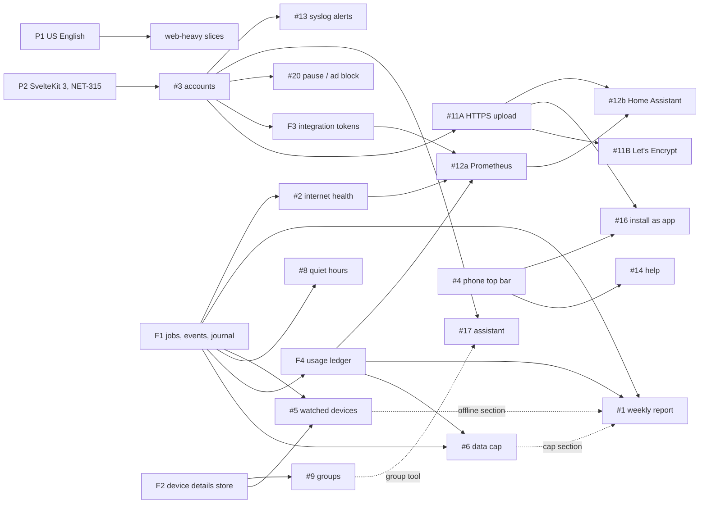

# Plan: Feature roadmap, the 20 missing features (2026-11-18)

_Codex APPROVED in round 5. It raised 20 points in round 1, 11 in round 2, 1 in round 3 and 1 in round 4; all were accepted.
- Round 1 added: the usage-ledger foundation (F4), the event journal and job contract in F1, and rollback procedures.
- Round 2 added: the journal's single writer and commit point, rejecting legacy tokens, an ownership protocol for UniFi pauses, and fixes to the HA, SIEM and DNS details.
- Round 3 replaced F4's ingestion watermark with idempotent per-day recounts kept as a high-water mark, because Malcolm stamps `event.ingested` before a record is written.
- Round 4 made F4's "complete" flag depend on coverage evidence (an index inventory and vanished indices), not on totals falling.
Review log: `plans/2026-11-18-feature-roadmap-review-log.md`. Branch: `docs/feature-roadmap-2026-11-18`. Linear project: [Feature roadmap 2026-11 (P-NET-1)](https://linear.app/nettap/project/feature-roadmap-2026-11-f03d2497c8c9), issue IDs per slice below. Code state: origin/main `a7e4d810`._

This is a plan only. It fixes the order, scope, shared foundations and default decisions for all 20 features found missing in the 2026-11-18 review. **Every slice still gets its own plan and `/codex-review` before its code**, following `.claude/rules/git-workflow.md`. This roadmap is the input to those plans, not a replacement.

---

## 1. Goal

Ship all 20 features from the review, fully integrated (daemon API, page, pytest, Vitest, visual tests, deploy script, G11 check), in an order that:

- builds each shared piece once;
- keeps NetTap inside its hard limits until v1.0: no cloud dependency, no telemetry, no subscription, read-only visibility, passive capture, and a 16 GB N100-class box (the G11 shows 11.9 GB with swap 91% full);
- puts every feature that breaks a limit after v1.0, opt-in, with a fail-safe.

## 2. Summary

| Milestone | What | Slices | Effort |
|---|---|---|---|
| **M0 Prerequisites** | US English switch (pickup point), SvelteKit 3 upgrade (NET-315), G11 memory baseline | P1, P2, P3 | existing plans |
| **M1 v1.0 must-have** | Accounts, notification foundation (jobs + event journal), usage ledger, data cap, quiet hours, device details, watched devices, internet health, phone top bar, weekly report | #3, F1, F4, #6, #8, F2, #5, #2, #4, #1 | 2 L, 5 M, 3 S/S–M |
| **M2 Should-have** | SNI categories + JA4, groups, Feodo feed, HTTPS upload, tokens + Prometheus + Home Assistant, syslog alerts, help, saved views, passive services list | #7, #9, #10, #11A, F3, #12a, #12b, #13, #14, #15, #18A | 8 M, 3 S/S–M |
| **M3 Post-v1.0** | Let's Encrypt, install as app + ntfy, Wake-on-LAN, active port check, local assistant, pause and ad blocking | #11B, #16, #19, #18B, #17, #20 | 3 L, 1 M, 2 S |

M2 slices may land before the v1.0 tag if they are ready, but they do not gate it. M3 slices land after v1.0 because they break a hard limit (#11B outbound plus public CT logs, #17 sends network data to a model server, #18B active probing, #20 blocking) or are nice-to-haves that depend on one (#16 needs #11). #19 breaks no limit and may be pulled forward (decision D21).

**Critical path for v1.0:** F1 → F2 → #5 → #1 (L + S + M + L). F4 → #6 runs alongside it and must land before #1. Everything else in M1 runs in three lanes:

- **Lane A, daemon notifications:** F1 → F4 → #6 → #8 → F2 → #5 → #1.
- **Lane B, web and auth:** P1 → P2 → #3 → #4.
- **Lane C, internet:** #2. It needs only F1's job contract, so it can start as soon as F1 merges, in parallel with F4.

**First slice to start:** F1 (the notification foundation). It is daemon-only, so it does not collide with the web-wide P1/P2 work, and three must-haves wait on it.

## 3. Corrections to the 2026-11-18 review

The review was checked against origin/main `a7e4d810`. These findings change the plan:

1. **Only alert notifications are ever sent.** `AlertDispatcher._routed` asks only for `"alert"` (`daemon/services/notification_dispatcher.py:207`), and `NotificationHub.process_event` (`notification_hub.py:968`) has no callers. The rule builder still offers `new_device`, `anomaly`, `storage_warning`, `smart_warning`, `capture_error` and `system_error` (`web/src/routes/settings/tabs/NotificationsTab.svelte:183-188`), and none of them ever fire. The review listed "new-device notifications" as covered. That was wrong, and F1 fixes it.
2. **The internet health monitor never runs.** `daemon/api/server.py:1218-1219` creates it and registers routes. Only `POST /api/internet/check` calls `run_check` (`daemon/api/health_monitor.py:66`). The history is empty, not 24 h. The check button would also time out: the web proxy's 10 s default is shorter than a check (11–20 s).
3. **The phone layout mostly exists.** `system.css:416-451` has container queries at 1100 and 760 px, and `+layout.svelte:196-290` has the phone drawer. The real gap: `.topbar` is hidden under 760 px and nothing replaces search, the bell, Refresh or the offline warning. #4 shrinks from L to S–M.
4. **`createUser` and `updatePassword` have no callers at all.** The setup wizard uses `createFirstAdmin`. No code checks the role in the JWT, and signing out does not revoke a token.
5. **No page can set the data cap.** `setBandwidthCap` (`web/src/lib/api/bandwidth.ts:258`) has no caller.
6. **The scheduled-report sections are placeholders.** `report_generator.py:311-405` returns made-up compliance and risk figures (score 100, "pass", "low"), and `reports_dir` is never written.
7. **`config/zeek/nettap.zeek` is not loaded.** The mount is commented out (`docker/docker-compose.yml:446-451`), so Zeek changes go in zeek-live's `environment:` block. QUIC has been on since NET-219. Malcolm's JA4 output already arrives (ja4d records, `device_registry.py:969`), but `mac_correlator.py` reads `tls.ja3`, which is empty on the G11.
8. **`config/suricata/update-sources.yaml` is not used.** The real sources are `SURICATA_UPDATE_ENABLE_SOURCES` (`docker-compose.yml:536`).
9. **Threat intel is wider than "ET compromised".** `LISTING_RULES` matches COMPROMISED, DROP, CINS and Dshield (`threat_intel.py:66-76`). The `abuse_ch_feodo`, `sslbl` and `dshield` entries in `TI_FEEDS` are never filled.
10. **The HTTPS certificate comes from the installer, not `generate-cert.sh`.** `generate-cert.sh` has no caller. The installer signs a certificate with a local CA in `malcolm-config.sh:256-315`.
11. **`NotificationPrefsCard.svelte` is more than a severity threshold.** It also has email and webhook toggles; only quiet hours and a digest are missing.
12. **Path MTU lives in `path_mtu_service.py`,** not `network_diag_service.py`.
13. **Monthly usage is not durable.** `bandwidth_tracker.py:177` sums the raw records that still exist, and pruning (`storage/manager.py:583`) can delete earlier days. The month's total can therefore go down, and month boundaries are UTC. Cap alerts need a durable ledger first (F4).
14. **Report schedules sit in a strict loader.** `report_generator.py:75` builds `ReportSchedule(**data)` and clears every schedule on an unknown field. New schedule fields need a sidecar file (#1).
15. **The internet monitor's default targets are public** (Google, Cloudflare and OpenDNS addresses and names, `internet_health.py:48`). Loss is measured against the first target only (`:253`), and the internet counts as "down" at 50% loss (`:207-209`).
16. **Writes to `users.json` can be lost.** `createUser` and `updatePassword` read the whole store, await the password hash, then overwrite the file (`auth.ts:184-200, 237-246`). Two writes at once can undo each other.
17. **`/etc/nettap/suricata.env` is owned by ET Pro.** `etpro.py:157` rewrites it with the ET Pro code alone, and clearing ET Pro deletes it.
18. **The UniFi client never checks the controller's certificate** (`ssl=False`, `unifi_integration.py:328`).
19. **The PRD says syslog forwarding is a MUST** (`NetTap_PRD_v1.0.md:80,134`), so #13 is closer to must-have than its "should-have" rank suggests. It stays in M2 because alert forwarding (13A) is M effort and nothing in M1 depends on it. Decision D17 covers it.

## 4. Rules every slice follows

- **Branch and plan:** a fresh worktree off `origin/main` per slice (`feature/<name>`, `fix/<name>`). Write a `PLAN.md`, run `/codex-review` (wrapper with `< /dev/null`), implement, then `/deep-review` (on its triggers) and `/ponytail-review` before commit. Run the two-angle review before merging anything that touches auth, credentials, bridge or bypass, install, OpenSearch security or the daemon API.
- **Tests:** `cd daemon && python -m pytest`, `cd web && npx vitest run`, `npx svelte-check`, `npm run check:colors`, `npm run test:visual`. Add a slice's new page to `web/e2e/visual/routes.ts`. CI must add no new failures.
- **UI:** follow `web/DESIGN-SYSTEM.md`. Use the page recipe, `CardState`, `registerPageRefresh`, sortable `DataTable` and tokens only. New settings go on a Settings tab, never a sub-page. Shell, phone, popover, tour and icon changes go into `nettap-design-system/` first, then get copied. Network-supplied strings (host names, server names, user agents, alert text, notes) render as text only, never `{@html}`. Copy follows the spelling rule in `DESIGN-SYSTEM.md` at the time; after P1, that is US English.
- **State files:** use `/opt/nettap/data/<name>.json`, written with `write_file_atomic`, mode 600, with a section in the config backup unless it is a secret.
  - **Rollback safety:** stores whose readers reject unknown keys (`device_custom.py:167`, `_validated`) get a new file instead of new keys. The old code must still start after a rollback.
- **Outbound calls:** off by default. Each one is owner-triggered or opt-in, and named in the UI with what it sends and to whom.
- **Dependencies:** none unless the slice plan justifies it. Licences go in `THIRD-PARTY-LICENSES.md`. No EULA-bound tools or data.
- **Code preservation:** replaced logic is wrapped in `OLD CODE START/END` with the reason.
- **Deploy:** add `scripts/remote/deploy-<name>.sh` in the mandatory template (`set -u`, numbered steps, health polling, API checks). Deploy and verify on the G11 via `ssh nettap`. Before and after every G11 trial, record `free -m` and `sudo docker stats --no-stream`. A slice that adds more than 50 MB resident or measurably raises swap use stops for review.
- **Tracking:** each slice keeps its Linear issue current, updates `Debugging/RELEASE-VERIFICATION.md` (or `DEPLOYMENT-ISSUES.md` / `BRIDGE-ARCHITECTURE.md` when it touches them), and ticks its row in this file.

## 5. Hard-limit conflicts

| Item | Limit touched | Design | Fail-safe |
|---|---|---|---|
| #2 internet monitor | Recurring probes to public addresses and names | Off until the owner presses "Start monitoring" on the Internet page. That card names every probe destination, and the targets are editable. | Off means no probes; a test proves it. |
| #2 speed test | Outbound call to a third party | Owner presses a button; never scheduled. The page says which server and how much data. | Nothing inline. The rest of the page works offline. |
| #10 threat feeds | Outbound download; third-party terms | Only the Feodo Tracker list (CC0), opt-in toggle. URLhaus and ThreatFox are excluded: they need an Auth-Key and are not-for-profit only. | A Suricata source that fails to download leaves the existing rules in place (rules lock). |
| #11B Let's Encrypt | Outbound to the ACME provider and a DNS API; the host name is published in Certificate Transparency logs | Off by default, after #11A. Recommend a wildcard certificate. | Revert to the installer certificate, reachable by IP. Drop `includeSubDomains` from HSTS first (D13). |
| #16 push | Web Push runs through Google, Mozilla or Apple push services | **Web Push dropped.** Use a manifest plus ntfy (self-hosted, already reachable through the webhook channel). | None needed. |
| #17 assistant | Sends network data to a model server; no RAM for a model on the box | Off by default. The endpoint must be a private or ULA address on the owner's LAN. Read-only tools only. | No write tools, so injected text can only distort an answer. Answers render as plain text. |
| #18B active port check | Not passive | Owner-pressed, per device, directly connected subnets only, about 30 TCP ports, no nmap (NPSL). | 20 s deadline, one check at a time, refuses public and routed addresses. |
| #19 Wake-on-LAN | Sends one packet | Owner-pressed. | Rate-limited per MAC. |
| #20 pause and ad blocking | Breaks read-only visibility | After v1.0, off by default, per capture mode. No pause in bridge mode: post-NAT, every frame carries the router's MAC. UniFi control requires a verified controller certificate or an enrolled fingerprint pin. Gateway control stays unavailable until a network-namespace or VM harness proves it. | Gateway mode: pauses expire in the kernel (`--datestop`), a reboot clears them, and ad-block DNS falls back to the router. UniFi pause is **not** fail-open. Mitigations: a 12 h cap, a durable pause journal that is cleaned up before disable, a controller change or a downgrade, and the page names the UniFi app as the way to undo it. |

## 6. Dependency graph

Solid arrows are hard dependencies; dotted arrows mean the later slice works without the earlier one but is richer with it. #7, #10, #15, #18A, #18B and #19 depend only on M0.

---

## 7. M0: prerequisites

| ID | What | Why first | Status |
|---|---|---|---|
| P1 | US English switch across the web app (current pickup point) | Every slice writes UI copy. Switching first avoids rewriting new copy twice. | Not started; no Linear issue yet. Create it when the slice starts. |
| P2 | SvelteKit past 3.1.0 (NET-315, High) | #3, F3, #12a and #16 change `hooks.server.ts` and the catch-all proxy. Upgrading first avoids rebasing auth code across a framework major. | Todo |
| P3 | G11 memory baseline | Swap is 91% full. Every slice must compare against a recorded baseline. Run `ssh nettap 'free -m; sudo docker stats --no-stream --format "table {{.Name}}\t{{.MemUsage}}"'` and save the output in `Debugging/RELEASE-VERIFICATION.md`. | A 1-minute task. |

Lane A (F1) does not wait for P1 or P2: it is daemon-only, and its two new labels in `NotificationsTab.svelte` are trivial to rebase.

---

## 8. M1: v1.0 must-have

### F1: Background jobs, notification events and the event journal (foundation)

- [x] **Done 2026-11-18 (NET-319, `feature/f1-notification-foundation`).** As the slice plan `plans/2026-11-18-f1-notification-foundation.md` narrowed it:
  - F1 sends `new_device` only. Each later slice adds its own event type when it adds the sender.
  - `GET /api/events` moved to #1. **Amended 2026-11-21 (NET-340):** deferred again, NET-352. #1 reads the journal in-process through `EventJournal.scan()`, so nothing consumes the route yet.
  - The only job is `journal-compact`.

- **What the owner gets:** offline, data-cap, new-device and report messages arrive on the same channels, with the same daily limits and retries as alerts. The rule builder offers only event types that actually fire. Settings shows when each background check last ran. Weekly reports can count incidents even across restarts.
- **Scope:**
  - **Events:**
    - Add `device_offline`, `device_online`, `data_cap` and `report` to `EVENT_TYPES` (`notification_config.py:15`).
    - Add `AlertDispatcher.emit(event, key, line, severity)`, which puts the event in a saved outbox (cap 200). Each poll turns the outbox into items keyed `event:key` and routes them by (event, severity). The early "nothing routed" return must not skip the outbox.
    - Saved items without an `event` field load as alerts, so existing state keeps working.
  - **Job contract** (`daemon/services/scheduled_jobs.py`): one cleanup_ctx task ticking every 60 s, with a "next due" dict like `beacon_snapshots.run_forever`.
    - **Bounded admission:** jobs run on a dedicated 2-worker executor, never the route pool.
    - **No overlap:** a job that is still running is skipped and counted, never started twice.
    - **Worker lifetime:** a slot stays held until the thread really finishes, as `drilldown_runner.py:179` does. A timed-out caller does not free capacity.
    - **Cooperative deadlines:** every OpenSearch call passes a request timeout and the query `timeout`. A partial result is reported as partial.
    - State lives in `/opt/nettap/data/scheduled-jobs.json`, with `last_run`, `last_error`, `last_duration_ms`, `skipped_overlaps` and the peak RSS sampled during the run.
  - **Event journal:** `/opt/nettap/data/events.jsonl`, append-only.
    - Each line is `{id, type, key, observed_at, recorded_at, data}`, with a stable `id` = sha256 of type, key and observed_at.
    - It records new devices, offline/online transitions, data-cap crossings and report deliveries.
    - The notification history (100 in memory, `notification_hub.py:525`) is not a record; the journal is.
    - **One serialised writer.** A single journal object owns the file behind one lock, for appends, compaction and torn-tail repair alike. Nothing else opens it for writing.
      - **Appends** are `write` + `fsync`.
      - **Compaction** (daily: 120 days or 50,000 lines) writes the kept lines to a temp file and swaps it in with `write_file_atomic` under the same lock, so a concurrent append can't be lost.
      - **A torn tail** found at startup is truncated, not skipped, before the first append.
    - **The journal is the commit point.** A producer (watched job, data-cap job, new-device check) appends its event first. Only then does it advance its own state (last device state, thresholds sent, registry watermark). Notification delivery is driven from journal events through the outbox, and the outbox records the last journal `id` it took.
    - Recovery: after a crash, the producer re-derives its state from the journal, and the outbox resumes after its last `id`. An event can be delivered twice (dedup by `id` in the outbox), never lost.
  - **New-device detection** uses the registry's registration time (when NetTap first stored the MAC), not `first_seen` (observation time, `device_registry.py:262`). A late discovery therefore can't fall behind the polling watermark. Add a `registered_at` field to the registry if none exists, and backfill it with the current time once, so the first run sends nothing.
  - **Make the rule builder honest:**
    - wire `new_device` from the journal;
    - hide `anomaly`, `storage_warning`, `smart_warning`, `capture_error` and `system_error` until each has a sender (follow-up issue).
  - Quick settings (`notification_config.py:283`) create the fixed rules `settings-offline`, `settings-datacap` and `settings-newdevice`.
- **Out:** senders for the five hidden event types.
- **Reuse:** `notification_dispatcher.py` (cooldown, retry, daily cap, digest), `notification_hub.py`, `beacon_snapshots.py`, `api/drilldown_runner.py` (slot accounting), `capture_config.write_file_atomic`, `device_registry.py`.
- **Daemon:** `GET /api/notifications/jobs` (read-only job state) and `GET /api/events?type&from&to` (read-only journal query, used by #1). **Amended 2026-11-21:** `GET /api/events` is deferred (NET-352); #1 reads the journal in-process.
- **Web:** event labels in `NotificationsTab.svelte`; quick-settings toggles in `NotificationPrefsCard.svelte`; a "Background checks" table on the Notifications tab.
- **Tests:**
  - `test_notification_dispatcher.py`: emitted events follow their own rules, old state still loads, events count against the daily cap, the outbox survives a restart, and alert-path behaviour is unchanged.
  - New `test_scheduled_jobs.py`: overlap is skipped; a hung worker keeps its slot; at most 2 jobs run together; a deadline gives "partial"; state survives a restart.
  - New `test_event_journal.py`:
    - stable IDs;
    - a torn tail is truncated before the next append;
    - compaction running concurrently with appends loses nothing;
    - crash points: after the append but before the producer state, and after the producer state but before the outbox;
    - recovery delivers each event at most twice and never loses one;
    - no duplicate on replay;
    - a device registered late still fires once;
    - the backfill on first run sends nothing.
  - `test_notification_config.py`; web `notifications-tab.test.ts` (hidden types are not offered).
- **Gates:** `/deep-review` (daemon/api) and the two-angle review (daemon API).
- **G11 cost:** one task and a 2-thread pool; under 5 MB steady; journal under 20 MB at its cap; no outbound calls. The deploy samples peak RSS during a forced run of every job, not just before and after.
- **Deploy and G11 check:** `deploy-notification-foundation.sh`.
  - `/api/notifications/jobs` shows every job with `last_run` under 10 min old and `last_error` null.
  - The dispatch state keeps its `cursor`.
  - A new device on the LAN (plug in a phone with a fresh randomised MAC) produces one journal line and one "New device" entry in `/api/notifications/log`, and no repeat after a daemon restart.
- **Effort:** L. **Depends on:** nothing.
- **Risks:** this is the alert path, with existing security fixes (D3, M2). The existing dispatcher tests must pass unchanged.
- **Decision:** D1. **Linear:** NET-319.

### F4: Durable usage ledger (foundation)

- [x] **Done 2026-11-18 (NET-329, `feature/f4-usage-ledger`).** As the slice plan `plans/2026-11-18-f4-usage-ledger.md` (Codex-approved in round 5) changed it:
  - **One writer.** A single `usage-ledger` job runs every 15 min: the last 3 days, then a saved sweep cursor through the older days. There is no separate nightly job.
  - **Coverage loss is permanent evidence.** Indices are tracked by UUID. The time zone defaults to UTC until the owner picks one.
  - **The whole Bandwidth page uses the owner's month,** and `/api/bandwidth/cap` reads the ledger.
  - **Not done here:** the data-cap warning, the weekly report and Prometheus read the ledger in #6, #1 and #12a.

- **What the owner gets:** monthly usage that never goes down when old raw data is pruned, counted in the owner's own time zone, and an honest "counted since" date when history is incomplete.
- **Scope:**
  - **Why not count each record once as it arrives:**
    - Connection bytes arrive only when a connection finishes: interim records are excluded (`excluded_ips.py:504`), and bytes are attributed to the connection's start time (`bandwidth_tracker.py:245`). So a multi-day connection lands in an old day late.
    - Records can also become searchable late. Malcolm stamps `event.ingested` in its Logstash enrichment filter **before** the OpenSearch output writes the document (Malcolm v26.10.0 `20_enriched_to_ecs.conf:77`). With output backpressure, a record can appear after any time window that counted "everything ingested up to T".
    - So a one-way watermark over `event.ingested` would lose bytes permanently.
  - **Replay-safe accounting: a high-water mark of idempotent recounts.**
    - Each pass recomputes a local day's total from scratch: the same aggregation and filters as `get_daily_usage`, over `@timestamp` within that local day, across all indices.
    - It stores `days[D] = max(days[D], recount(D))`. A recount is a full sum, so running it twice changes nothing and a record is never counted twice. A record that becomes visible late, or a long connection that finishes days later, is simply in the next recount of its day.
    - Totals never go down: once pruning removes some of a day's raw records, the stored maximum keeps the earlier, larger total.
  - **Schedule (F1 jobs):** today, yesterday and the day before are recounted every 15 min. Every day still present in raw data is recounted once a night, so late records for older days are picked up too.
  - **Completeness comes from coverage evidence, never from totals going down.** Deletions and late records can cancel out (100 GB stored, 60 GB pruned, 80 GB arrives late, the recount shows 120 GB), so a falling total is not enough to detect pruning.
    - **Index inventory:** each pass records the set of raw indices it summed, and each index's `@timestamp` min and max (cached; it only changes for the index being written).
    - **Vanished index = pruning evidence,** whoever deleted it (NetTap's storage manager, `manager.py:583`, or Malcolm's ILM/ISM). Every local day overlapping a vanished index's `@timestamp` range becomes `complete: false` with `pruned_seen_at`. The only exception is a day already **settled**: a recount with no index missing ran at least 72 h after the day ended.
    - **The nightly pass walks the ledger's days, not only days still in raw data,** so a day whose raw records vanished entirely is still re-marked by the same rule. Its stored total stays.
    - **When coverage can't be checked** (the inventory is missing after an upgrade or a lost file), the affected days are marked `complete: false`.
    - A recount lower than the stored value is extra evidence and also marks the day.
    - **Stated limit:** connections that finish more than 72 h after their start day ended, after that day was pruned, may be missed. The UI says "approximate after <date>" for any `complete: false` day, and #6 skips its projection for such a month.
    - Days already pruned before the ledger existed are "not counted", and `since` says where counting starts.
  - `/opt/nettap/data/usage-ledger.json` holds `{version, tz, since, indices: {name: {min_ts, max_ts}}, days: {YYYY-MM-DD (local): {download, upload, complete, settled_at?, recounted_at, pruned_seen_at?}}}`. Written atomically. Bounded to 400 days. Changing the time zone starts a new ledger (the old one kept as `.prev`), never a silent recount.
  - **One ledger-backed contract for everyone:** `GET /api/usage/daily?from&to` and `GET /api/usage/month` return `{bytes, since, complete, gaps}`. `/api/bandwidth/cap`, the Bandwidth page's monthly figure, #6, #1 and #12a all use it. The old UTC functions stay for their other callers (OLD CODE note).
- **Out:** per-device ledgers, billing-day months (D4).
- **Reuse:** `bandwidth_tracker.py` (`get_daily_usage`, `get_monthly_usage`, `get_projected_monthly`), F1 jobs, `write_file_atomic`.
- **Tests:**
  - `test_usage_ledger.py`, **a prerequisite for #6, #1 and #12a**:
    - **late visibility:** a record whose `event.ingested` is older than an earlier pass, but which becomes searchable only after that pass, is counted exactly once on the next recount;
    - running the same recount twice changes nothing;
    - a 3-day connection finishing today raises its start day once;
    - pruning raw data never lowers a stored total, and marks the day `complete: false`;
    - **offsetting change:** an index is deleted and late records add more than it held before the next pass; the total rises and the day is still marked `complete: false`;
    - **whole-day disappearance:** every raw record for a day vanishes; the nightly pass keeps its total and marks it unless it was settled;
    - an index deleted by ILM (not NetTap) is detected the same way;
    - a missing index inventory marks the affected days `complete: false`;
    - a crash between recount and save loses nothing (the next pass recounts);
    - daemon downtime: the nightly pass catches up every retained day;
    - local month boundaries (UTC−8, UTC+13, a daylight-saving day);
    - time-zone change; first run marks earlier days "not counted"; the cap.
- **Gates:** `/deep-review` (new `daemon/api` routes).
- **G11 cost:** 3 day-sized aggregations every 15 min (about what one Bandwidth page load costs today), and one per retained day each night, spread one at a time by the F1 job contract. Ledger under 50 KB. The deploy check times both passes and records peak RSS.
- **Deploy and G11 check:** `deploy-usage-ledger.sh`.
  - After the first pass, `/api/usage/daily` for yesterday equals a fresh raw recount of yesterday exactly. For a day with no pruning, both use the same aggregation.
  - A daemon restart and a forced repeat pass change no total.
- **Effort:** M. **Depends on:** F1.
- **Decision:** D4. **Linear:** NET-329.

### #3: Change password and viewer accounts

- **What the owner gets:** Settings › Accounts. Changing your password signs out every other session. The admin can add viewer accounts that see everything and change nothing.
- **Scope:**
  - **Serialised store writes (first).** Every write to `users.json` goes through one in-process mutex that re-reads the file inside the lock, applies the change, and writes atomically. This covers create, delete, password change, reset and first admin. Password hashing happens before taking the lock, and the change is checked again inside it (for example, the user still exists). Today `createUser` and `updatePassword` read, await a hash, then overwrite, so concurrent writes can undo each other (`auth.ts:184-200, 237-246`). The web server is one Node process, so an in-process mutex is enough; the slice plan confirms adapter-node runs no cluster.
  - **Session binding:** add an immutable `accountId` (random UUID, new on every create) and a `tokenVersion` to each user. The JWT carries `aid` and `tv`.
    - `updatePassword` and admin reset increment `tokenVersion`.
    - `hooks.server.ts` re-reads the user after `verifyToken`, rejects a missing user, an `aid` mismatch or a `tv` mismatch, and takes `role` from the store.
    - Deleting and recreating a username gives a new `accountId`, so an old token can't match the new account.
    - **Upgrade:** existing users get an `accountId` on first read. **Tokens without `aid` are rejected; there is no compatibility exception.** Everyone signs in again once after this deploy, and the release note says so.
  - **One viewer gate:** in `hooks.server.ts`, any method other than GET or HEAD from a non-admin gets 403, unless it is in the exact allowlist `VIEWER_WRITES`:
    - logout and own password change;
    - the read-only POSTs `/api/packets/search`, `/api/packets/check-filter` and `/api/tshark/analyze`.
    - Viewers are also blocked from `GET /setup`, backup export and PCAP download.
  - **Routes:** `routes/api/account/password/+server.ts` checks the current password with `attemptLogin`, so its rate limit applies. `routes/api/account/users/+server.ts` (admin only) handles list, create viewer, delete and reset.
  - Move the password rules from `setup/+page.server.ts` into `auth.ts` as `passwordProblem()`.
- **Out:** more than one admin, 2FA, mapping viewers into OpenSearch Dashboards.
- **Reuse:** `auth.ts` (`createUser` :179, `updatePassword` :236, atomic `writeUsers`), `login.ts` `attemptLogin`, the `FIRST_RUN_REQUESTS` exact-set pattern (`hooks.server.ts:94`), `middleware.ts` `setAuthCookie`.
- **Daemon:** none; the daemon never sees users.
- **Web:** new `settings/tabs/AccountsTab.svelte` (General group). `+layout.server.ts` returns `role`. Viewers see the Accounts tab only, and other write buttons are disabled with "This account can only view."
- **Tests:**
  - `auth.test.ts`: concurrent create, delete, password change and reset never lose a write. A deleted then recreated username rejects the old token.
  - `hooks.server.test.ts`: viewer 403 for every non-GET outside the allowlist; old `tv` → 401; `aid` mismatch → 401; a legacy token without `aid` → 401, including after a reset and a restart; role read from the store.
  - Route tests and `AccountsTab.test.ts`.
  - Playwright `e2e/accounts.spec.ts`: after a password change, the second browser gets 401.
  - Visual `/settings?tab=accounts`.
- **Gates:** `/deep-review` (lib/server, hooks, api routes) and the two-angle review (auth).
- **G11 cost:** one small `users.json` read per request.
- **Deploy and G11 check:** `deploy-accounts.sh` (web only). The admin password is read with `read -rs` and never stored. The script then:
  1. creates the viewer `g11check-$RANDOM`;
  2. as the viewer, expects `POST /api/settings/excluded-ips` = 403 and `GET /api/system/ping` = 200;
  3. deletes the viewer;
  4. checks that an unauthenticated `POST /api/account/password` = 401.
- **Effort:** M. **Depends on:** P2.
- **Rollback (`rollback-accounts.sh`):** older builds trust any valid JWT and check no role (`hooks.server.ts:159, 272-283`). Downgrading with viewers or revoked tokens around would give viewers admin access. The script must:
  1. **close access:** stop `nettap-nginx`, so nothing can reach the web app during the swap;
  2. remove every non-admin user from `users.json`;
  3. **rotate the effective secret.** `JWT_SECRET` in the environment beats `jwt-secret.txt` (`auth.ts:24`). If the compose or `.env` sets `JWT_SECRET`, the script refuses to continue and prints how to rotate that value. Otherwise it rotates the file.
  4. deploy the older build;
  5. still closed, check from inside the network (`docker exec`) that a viewer token and a pre-change admin token captured earlier both get 401;
  6. only then start nginx again.
  - Any failed check leaves nginx stopped and says why.
- **Risks:**
  - `/dashboards/` gets `X-Forwarded-Roles: viewer` (`nginx.conf:285-299`). It should fail closed because the role is unmapped. Check this on the G11.
  - A missed write route is blocked by default (fail-closed), which is the safe direction.
- **Decision:** D8. **Linear:** NET-321.

### #6: Data cap warnings

- [x] **Done 2026-11-20 (NET-339, `feature/f6-data-cap-warnings`).** As the slice plan `plans/2026-11-18-f6-data-cap-warnings.md` (Codex-approved in round 5) changed it:
  - **The journal is the only record of "sent".** No job state: each warning is one append keyed by `(threshold, "<YYYY-MM>|<cap bytes>")`, kept past the journal's line cap for 62 days. A new cap re-arms; returning to an earlier cap sends nothing again.
  - **Every 15 min from the ledger's snapshot, not hourly from OpenSearch.** Thresholds use a lower bound counted under the current exclusions, so a changed exclusion can't fake a crossing.
  - **Only the current month and cap are sent.** A queued warning for a cap the owner has left is held; one for a month that is over is dropped. A crossing first accounted after the month's last local midnight is not warned about (stated limit).
  - **Each message is fitted to the service's length limit,** and a data cap warning it didn't show waits for the next one (other events stay in "and N more").
  - **Deploy:** `deploy-data-cap-warnings.sh` (a synthetic crossing under a 1.234567 GB test cap, then the owner's cap restored).

- **What the owner gets:** a warning at 80% and 100% of the monthly cap, and one when the month is on track to go over. A place to set the cap.
- **Scope:**
  - An hourly `data_cap` job reads the month from the F4 ledger (local time zone), never from raw records that pruning can shrink. `/api/bandwidth/cap` switches to the same ledger figure, so the page and the alert agree.
  - Each threshold is sent once per local month: `80` (medium), `100` (high), `projected` (medium, only after day 3). Each crossing is written to the F1 journal.
  - When the ledger says the month is incomplete ("counted since 12 Nov"), the message and the card say so, and the projection is suppressed.
  - New "Monthly data cap" card on Settings › Network. The Bandwidth page links to it when no cap is set.
- **Out:** a billing-cycle start day, caps per device.
- **Reuse:** the bandwidth tracker, `PUT /api/settings/bandwidth-cap`, `setBandwidthCap`.
- **Daemon:** the job in F1. Its state `{month, sent}` is in `scheduled-jobs.json`.
- **Web:** the card and the link.
- **Tests:** `test_scheduled_jobs.py` (thresholds, once a month, reset on a new month, a failed query sends nothing); Vitest for the card.
- **Gates:** none beyond F1, unless `api/bandwidth.py` changes.
- **G11 cost:** one month-sized aggregation an hour, the same as a Bandwidth page load. The check times `/api/bandwidth/cap` (must be under 5 s).
- **Deploy and G11 check:** `deploy-data-cap-alerts.sh`.
  1. PUT a 1 GB cap.
  2. `/api/notifications/jobs` shows `"100"` sent this month.
  3. `/api/notifications/log` has a "Data cap" entry.
  4. Restore the real cap.
- **Effort:** S. **Depends on:** F1, F4.
- **Risks:** a ledger started mid-month undercounts that month; the "counted since" line covers it.
- **Decision:** D4. **Linear:** NET-339.

### #8: Quiet hours and a daily digest

- [x] **Done 2026-11-20 (NET-330, PR #340, `feature/f8-quiet-hours`).** As the slice plan `plans/2026-11-20-f8-quiet-hours.md` (six Codex rounds, owner sign-off) changed it:
  - **Quiet hours only.** The daily summary moved to NET-343: it needs saved per-channel state that the overnight window doesn't.
  - **The clock decides; nothing per window is saved.** `quiet` is `{enabled, start, end, critical_through}`, read in the owner's zone (F4), not a `tz` of its own. Held items carry `"held": true`, and the first send after the window releases them under one heading.
  - **The 50-alert cut ranks criticals that may go first, then worst first,** a held item ahead of a fresh one only at the same severity (review fixes).
  - **Backups carry it** as `notification_quiet`, with the zone it was set in; an invalid section refuses the whole import.

- **What the owner gets:** no notifications overnight. Everything held arrives as one summary in the morning, and critical alerts can still come through. Optionally, one summary a day instead of instant messages.
- **Scope:**
  - A hub-owned `quiet` key in `notifications.json`: `{enabled, start, end, tz, critical_through, daily_digest}`.
  - **`_commit` (`notification_hub.py:245`) must preserve `quiet`.** Otherwise every channel or rule save deletes it.
  - **Two queues per channel, not one timer.** Today `retry_at` applies to the whole channel (`notification_dispatcher.py:366`), and lines 386–405 send every candidate together. So:
    - **`held`:** items that arrive inside the window, with their own saved list.
    - **`pending`:** delivery retries, keeping their own `retry_at`.
    - A critical item (when `critical_through` is on) goes straight to `pending` and is sent alone. It never releases the held items with it.
    - **The quiet-hours check runs at every delivery attempt, not only on arrival.** That includes retries and items delayed by the daily cap. A non-critical retry that comes due inside the window moves to `held` instead of sending. So an item that failed at 21:59 doesn't retry at 22:00 in a 22:00–07:00 window.
  - **Saved digest windows:** each release records `{window_start, window_end, released_at}`. The held queue is released once per window end, as one digest, and a window that was already released is never released again. `daily_digest` is a window that ends at the chosen time each day. Consecutive days release once each, and a release can't defer itself.
  - The 50-item limit on each queue counts what it drops, so the digest can say "and N more".
- **Out:** quiet hours per channel. The in-app bell is unaffected.
- **Reuse:** `notification_dispatcher._deliver`, `record_held`, `quick_view` and `apply_quick_settings`; the browser time zone precedent (`web/src/lib/api/bandwidth.ts:213`).
- **Daemon:** extend `GET/PUT /api/notifications/config`. `tz` is validated against `zoneinfo.available_timezones()` and times as `HH:MM`. New backup section `notification_quiet`.
- **Web:** fields in `NotificationPrefsCard.svelte`.
- **Tests:**
  - Dispatcher: held inside the window; a failure at 21:59 whose retry falls at 22:00 is held, not sent; a cap-delayed item that comes due inside the window is held; a critical arrival during a hold is sent alone and the held items stay held; released as one message; a delivery retry during a window keeps its own timer; two consecutive daily releases each fire once; windows across midnight; daylight-saving days; the overflow count; restart mid-window.
  - Config validation; card Vitest.
- **Gates:** `/deep-review` and the two-angle review (daemon/api, backup restore).
- **G11 cost:** none; fewer messages sent.
- **Deploy and G11 check:** `deploy-quiet-hours.sh`.
  1. PUT a window covering now, then GET it back. Print only the `quiet` key; the file holds secrets.
  2. Trigger an alert with the UDP datagram trigger (see the `ids-trigger-and-reload-checks` memory). It sits in `pending`.
  3. When the window ends, one digest entry is delivered.
  4. Check time-zone data exists: `sudo docker exec nettap-storage-daemon python3 -c "import zoneinfo;print(zoneinfo.ZoneInfo('Europe/London'))"`.
- **Effort:** S–M. **Depends on:** F1.
- **Risks:** daylight-saving edge cases. The digest goes on the poll after `end` (up to 1 min late).
- **Decision:** D3. **Linear:** NET-330.

### F2: Device details store (foundation)

- **What the owner gets:** nothing visible by itself. It holds the per-device "watch" setting (#5) and group, owner and notes (#9).
- **Scope:**
  - New file `device_details.json` with `{version: 1, devices: {MAC: {watch_after_min?, group?, owner?, notes?}}}`, using the same store class pattern and lock as `device_custom.py`.
  - Limits: `watch_after_min` is 15, 30, 60, 240 or 1440; `group` up to 32 characters; `owner` up to 64; `notes` up to 1,000. No control or format characters; NFC.
  - `PUT` and `DELETE /api/devices/registry/{mac}/details`; `null` clears a field.
  - `present()` adds group, owner and watch to rows. Notes appear only on the device page.
  - New backup section `device_details`. Restoring an older backup without it leaves current values alone (the NET-200 rule).
- **Why a new file:** `_validated` in `device_custom.py:167` rejects unknown keys. New keys in `device_custom.json` would make a rolled-back daemon treat the whole store as damaged and lose every name and picture.
- **Out:** UI (that comes with #5 and #9).
- **Reuse:** `device_custom.py` (`normalize_mac`, `clean_name`, `_change`, `matching`, `present`, `export`, `restore`), `api/device_custom.py`, `config_backup.py:244-246, 462-482`.
- **Tests:** `test_device_details.py` (limits, control characters, merge, rollback: the old store still loads when the new file exists); backup round trip; an old backup leaves details alone.
- **Gates:** `/deep-review` and the two-angle review (daemon API).
- **G11 cost:** negligible (at most 2,000 entries).
- **Deploy and G11 check:** ships with #5.
- **Effort:** S. **Depends on:** nothing.
- **Decision:** D2. **Linear:** NET-320.

### #5: "Device went offline" alerts

- **What the owner gets:** "Tell me if this device goes quiet" on a device page. NetTap notifies you when a watched device goes silent, and when it comes back. A "Watched devices" card on Devices shows each one's state.
- **Scope:**
  - A `watched` job every 5 min makes one search, looking back at most 48 h across all datasets (conn including long connections, DNS, DHCP, NTP), for the newest `event.ingested` per watched MAC (at most 50). A device counts as heard if either:
    - it is `source.mac`; or
    - it is `destination.mac` on a connection it **answered**: responder packets or bytes > 0, or an established state (`ESTABLISHED_STATES`, `excluded_ips.py:526`), as `devices.py:302` `answered_by_ip` and `devices_v2.py:149` already do. Unanswered probes to a dead device never count as presence.
  - Every down and up transition is written to the F1 journal (`device_offline` / `device_online`), so #1 can count incidents across restarts.
  - **Pipeline check first:** if the newest indexed record is more than 10 min old (`pipeline_health.py`), change nothing. A stalled capture must not mark every device offline.
  - A device is "down" after two checks in a row with silence longer than its threshold. That sends `device_offline` (high). Coming back sends a low "back online after N min".
  - A newly watched device stays "unknown" until it is first heard.
- **Out:** confirming with ping (D5), watch schedules for devices that sleep, per-IP devices without a MAC.
- **Reuse:** `pipeline_health.py`, `DeviceDetailsStore` (F2), `devices_v2` query helpers.
- **Daemon:** `GET /api/devices/watched` returns `[{mac, name, after_min, state, last_heard, since}]`.
- **Web:** a watch option in `DeviceCustomise.svelte` (both device pages, per the two-device-pages rule); a "Watched devices" card on `/devices` (sortable `DataTable`, `CardState`).
- **Tests:**
  - `test_scheduled_jobs.py`: stale pipeline, two-check debounce, no repeat after a restart, back online. A NAS that only answers connections counts as heard; unanswered probes to a silent device don't. Transitions are journalled.
  - Vitest: customise and devices.
  - Visual: devices layout with the populated fixture.
- **Gates:** `/deep-review` and the two-angle review.
- **G11 cost:** one filtered aggregation every 5 min.
- **Deploy and G11 check:** `deploy-watched-devices.sh`.
  - PUT `{watch_after_min: 15}` on a known MAC. `/api/devices/watched` shows `state: "up"` and `last_heard` under 10 min old.
  - Owner check: unplug a smart plug and time the alert.
- **Effort:** M. **Depends on:** F1, F2.
- **Risks:**
  - **Bridge mode:** frames carry the router's MAC, so per-device watching cannot work. The option is hidden in bridge mode and the page says why.
  - Randomised MACs; phones that sleep; IoT devices holding one quiet long connection; indexing lag adds minutes.
- **Decision:** D5. **Linear:** NET-331.

### #2: Internet health page

- **What the owner gets:** a new "Internet" page. It shows whether the internet is up now, 30 days of outages (when, how long, router or provider at fault), latency, DNS time and packet loss, and a "Test speed" button.
- **Scope:**
  - **Monitoring is opt-in.** The default targets are public (`internet_health.py:48`: Google, Cloudflare and OpenDNS addresses and names), so the loop does not start until the owner presses "Start monitoring". That card lists every probe destination and lets the owner edit them (the gateway is always included). The setting is saved in `/opt/nettap/data/internet_health_settings.json`. While off, the page shows only the card and sends nothing.
  - **Run it as an F1 job** every 60 s (`INTERNET_CHECK_INTERVAL`), not a loop of its own, so the job contract covers it: no overlap, bounded workers, slots held until threads finish.
    - Today's resolver call is a `wait_for` around default-executor work that a timeout can't stop (`internet_health.py:105`), and the ping timeouts don't kill the child process. Replace both with `host_resolve`'s killable resolver and subprocess handling (`host_resolve.py:2`), which already solves this for the Tools pages.
  - **Keep per-target results:** gateway ping; each external target's reachability (ICMP plus a TCP 443 connect, so a target that drops ICMP still counts); latency and loss. Replace "loss against the first target ≥ 50% = down" (`internet_health.py:207-209, 253`) with one rule-based classification:
    - **up:** most external targets reachable.
    - **degraded:** some targets unreachable, or loss or latency over its threshold.
    - **router unreachable:** the gateway fails and every external target fails.
    - **provider down:** the gateway answers and every external target fails.
    - **unknown:** any other mix. One blocked target, or a gateway that ignores ICMP while the internet works, lands here or in degraded, never in an outage.
  - **DNS is tracked separately and never decides the outage cause.** The system resolver can answer from its cache throughout a WAN outage. DNS time and failures are a series of their own (a "DNS problem" note when targets are reachable but lookups fail).
  - **Persistence:** append to `/opt/nettap/data/internet_health.jsonl`. At start, load only the last 24 h and skip a torn last line. Once a day, rewrite the file atomically keeping 30 days.
  - `GET /api/internet/outages?days=30` works out outages in a thread. Times when NetTap wasn't checking show as gaps, never as outages.
  - **Speed test:** `POST /api/internet/speedtest {direction}` in `daemon/services/internet_speedtest.py` uses aiohttp, 4 streams, at most 10 s per direction, one at a time (409 when busy). The reply says which interface and link speed it ran over (`host_resolve.route_to`).
    - **Hard data ceiling:** 250 MB per direction across all streams and retries. The test stops at whichever comes first, the ceiling or 10 s, and says which. The confirmation states "uses up to 250 MB each way", the true maximum.
  - **Fix the check timeout:** add `internet-check: 35_000` and `speedtest: 30_000` to `TOOL_TIMEOUT_MS` (`web/src/lib/server/daemon.ts:67`).
- **Out:**
  - alerts when the internet comes back (they can use F1 later);
  - a home-page tile and custom targets;
  - speed-test history;
  - a "busiest moment" figure from captured traffic (Zeek writes a connection's bytes at one point in time, so that figure would be wrong).
- **Reuse:** `internet_health.py`, `api/health_monitor.py`, `web/src/lib/api/internet-health.ts` and its four proxy routes, the `AlertDispatcher.ctx` loop pattern, `write_file_atomic`, `host_resolve.route_to`, the one-at-a-time lock from `throughput_service.py`.
- **Web:** `web/src/routes/internet/+page.svelte` (page recipe: status KPIs, 24 h hero chart, outage table, speed-test card with a confirmation that states the data used). Add "Internet" to the Overview nav group. Proxy routes for `outages` and `speedtest`. This also closes NET-215's internet-health part.
- **Tests:**
  - pytest:
    - off-state: no probes sent; the loop doesn't start;
    - persistence, torn line, trimming;
    - classification: one blocked target; a gateway that ignores ICMP; real upstream loss; gateway up with every external probe down while cached DNS still answers (must be "provider down"); gaps;
    - 20 consecutive hung resolver and ping calls leave no extra threads or child processes;
    - speed test against a fake server, including stopping at the byte ceiling, and 409.
  - Vitest: client and page.
  - Visual: healthy, outage, unknown and speed-test error.
- **Gates:** `/deep-review` (daemon/api, subprocess, an outbound call) and the two-angle review.
- **G11 cost:**
  - About 20 ICMP packets and 3 DNS lookups a minute; about 1 MB RAM; about 6.5 MB disk over 30 days.
  - A speed test moves at most 250 MB each way.
  - **Mirror mode:** test traffic crossing a mirrored port reaches the capture NIC, which already drops frames above about 480 Mbit/s. Measure `rx_missed_errors` before and after a test.
- **Deploy and G11 check:** `deploy-internet-health.sh`.
  - With monitoring off, `tcpdump` shows no probe traffic for 2 min.
  - The script then turns monitoring on, and `/api/internet/health` is not `not_configured` within 90 s.
  - `internet_health.jsonl` grows one line a minute.
  - After a daemon restart, the history count is unchanged.
  - A speed test returns `error == null`, and `path.interface` is the management NIC.
  - Owner check: unplug the router's WAN for 3 min; one "provider" outage of about 3 min appears. A daemon restart shows a gap, not an outage.
- **Effort:** M. **Depends on:** F1 (job contract).
- **Risks:**
  - Cloudflare's terms for third-party clients on its speed endpoints are unverified (D7).
  - In DHCP gateway mode, the test goes from NetTap's own upstream address; the page says so.
- **Decision:** D7. **Linear:** NET-322 (related NET-215).

### #4: Phone top bar

- **What the owner gets:** on a phone, search, the notification bell, Refresh and the "can't reach NetTap" warning are all there, and every page fits the screen.
- **Scope:**
  - **Design system first:** update the `.m-top` layout in `nettap-design-system/README.md` (Layout), `components/Sidebar/README.md` and `bundle.css`. Today `.m-top .icon-btn` uses `margin-left: auto`, so the bar can't hold two buttons. Then copy `bundle.css` into `system.css` unchanged.
  - Add the bell, offline chip and a search button to `.m-top` in `+layout.svelte`. The search button opens the existing `TopBar` combobox full width.
  - **Page audit:** fix each page in its own `<style>` with `@container app (max-width: 760px)`.
- **Out:** turning tables into cards. Per `components/DataTable/README.md`, tables scroll inside their card.
- **Reuse:** `system.css:416-451`, `+layout.svelte:196-290` (drawer, focus trap, scrim), `a11y.css` phone corrections, the visual harness's 390 px horizontal-scroll check.
- **Tests:** new `e2e/visual/phone-shell.visual.ts` at 390 px (bell and search reachable, offline chip in error mode); `topbar.test.ts`.
- **Gates:** none mandatory.
- **G11 cost:** none.
- **Deploy and G11 check:** `deploy-phone-shell.sh` (web only) greps the new `aria-label` in `/app/build/client`. Owner check: open every nav page on a real phone at a 7-day range; no page scrolls sideways.
- **Effort:** S–M. **Depends on:** P1. Do it after P2 to avoid layout churn.
- **Risks:** real host names are longer than fixtures, so overflow may still show up on the G11.
- **Decision:** D9. **Linear:** NET-323.

### #1: Weekly summary report

- **What the owner gets:** a Reports page, and a weekly email covering traffic, alerts, new devices, data cap and offline incidents.
- **Scope:**
  - **Replace the placeholder sections** (`report_generator.py:311-405`, kept as OLD CODE) with real ones:
    - traffic: the F4 ledger, falling back to `get_daily_usage` for days not yet in the ledger;
    - alerts: `alert_intelligence.get_smart_alerts`;
    - new devices and offline incidents: the F1 event journal, so restarts lose nothing;
    - data cap: #6, through the ledger.
    - **Remove the fabricated compliance and risk sections.**
  - **Schedule fields go in a sidecar, not `report_schedules.json`.** The old loader builds `ReportSchedule(**data)` and wipes every schedule on an unknown field (`report_generator.py:75`). New fields (time zone, weekday, hour, `last_delivery`) go in `report_schedule_meta.json`, keyed by schedule id. `report_schedules.json` keeps exactly today's fields, so a rolled-back daemon still loads every schedule. A test runs the current loader against a file written by the new code.
  - **Honest coverage, per source:** each section states its own coverage. The G11 has kept as little as two days of raw data.
    - traffic: the ledger's `since` and gaps;
    - alerts: the later of the period start and the oldest retained alert;
    - devices and incidents: the journal's first entry.
  - Store reports in `reports_dir/<schedule>/<stamp>.json` (atomic, mode 600), keeping 12 per schedule.
  - `run_due(now)` runs a due schedule once after downtime, never once per missed week. Weekly runs on a chosen weekday and hour in the schedule's time zone, which fixes `_compute_next_run`'s monthly drift.
  - **Fix existing API bugs:**
    - validate recipients with `_is_address` and allow at most 10 (CR/LF injection into the To header);
    - `PUT /api/reports/schedules/{id}` must reject a non-object body.
  - <!-- OLD TEXT: Delivery through F1 (`report` event) for channels, plus a hub method that sends plain-text email to the schedule's recipients. (amended 2026-11-21, NET-340: the channel summary is deferred) -->
  - A hub method sends plain-text email to the schedule's recipients. **Amended 2026-11-21 (NET-340, owner sign-off at the plan gate):** the channel summary (a `report` journal event to Pushover, Discord or Telegram) is deferred to its own slice, NET-351. It needs its own consent, off by default and naming the channels; a durable pending event tied to the send claim; digest carry-over in the dispatcher; and a purge of held report items on downgrade. The claim keeps a `pending_event` field for it.
- **Out:** a posture section (it would mean porting `web/src/lib/posture/score.ts` to Python; link to Security posture instead), PDF, CSV.
- **Reuse:** `report_generator.py`, `api/reports.py`, `web/src/lib/api/reports.ts` (today imported only by its test), the four `web/src/routes/api/reports/*` proxies, `notification_hub._smtp_send` (:657).
- **Daemon:** `GET /api/reports/history` and `GET /api/reports/{id}/{stamp}`, both checked with strict patterns so no path is built from input. Each schedule records `last_delivery`.
- **Web:** new `/reports` page:
  - h1 "Reports";
  - KPIs: next report, last sent, delivery result, days covered;
  - the latest report as the hero;
  - a sortable history table and "Generate now".
  - Schedules are edited in a card on Settings › Notifications. Nav: Overview group. Use an existing icon; a new one fails the icon drift test. This closes NET-215's scheduled-reports part.
- **Tests:**
  - `test_report_generator.py`: no made-up values; coverage clamping; next run across daylight saving; `run_due`; keeping 12; offline incidents counted from the journal after a restart; the old loader still loads a schedules file written by the new code.
  - `test_reports_api.py`: CR/LF in recipients, path traversal, a non-object body.
  - Web: `reports.test.ts` and a page test.
  - Visual: populated and empty.
- **Gates:** `/deep-review` and the two-angle review (email credentials; network-supplied text inside email).
- **G11 cost:**
  - About 5 aggregations over 7 days, once a week; `get_smart_alerts` is the heaviest.
  - A few MB RAM; up to 12 × about 50 KB disk per schedule.
  - The check times "Generate now" (must be under 30 s) and records `free -m`.
- **Deploy and G11 check:** `deploy-weekly-report.sh`.
  1. POST a schedule, then generate.
  2. The traffic total equals `/api/usage/daily` (the ledger contract) summed over the same window, exactly. Alert counts equal the Alerts page for the alert coverage window.
  3. History lists the report and the file exists.
  4. `POST /api/notifications/test` proves SMTP works.
- **Effort:** L. **Depends on:** F1 and F4 (hard); #5 and #6 (sections appear when present).
- **Risks:** heavy queries while swap is high. Generation runs as an F1 job: one slot, no overlap with another generation, cooperative OpenSearch deadlines per section. A section that hits its deadline shows "partial" rather than wrong figures. "Generate now" joins the scheduled run if one is already in progress.
- **Decision:** D6. **Linear:** NET-340 (related NET-215).

---

## 9. M2: should-have

### #7: Site categories from server names, and JA4

- **What the owner gets:** Home's "Traffic categories" names real services. YouTube counts under Streaming instead of "Google", and Cloudflare-hosted sites under their own category instead of "Security & VPN". The MAC correlator's "these may be the same device" suggestions work again, using JA4.
- **Scope:**
  - Label each destination IP by the server name most of its TLS sessions used (`zeek.ssl.server_name`; QUIC handshakes land in ssl.log since NET-219). Fall back to the network owner (ASN).
  - New `_sni_ip_categories()` (composite scan, cached 10 min) in `traffic_classifier.py`. `get_category_stats` moves those IPs' bytes from their ASN category to their server-name category.
  - One shared `_category_query(cat)` for the three detail endpoints, so their totals still equal Home's (the #96 rule).
  - Extend NetTap's own `DOMAIN_RULES` with the G11's top ~500 server names; it covers about 17% of them today.
  - Switch `mac_correlator.py` (82, 136, 383-439, 514-519, 668) and `ConnectionDrawer.svelte:132` from JA3 to JA4. **What this does and doesn't do:** it makes the existing merge *suggestions* work again (they read an empty JA3 field today). It does not link two successive private MACs: `mac_correlator.py:630` compares a randomised MAC only against globally administered ones. Linking a phone across random MACs stays with NET-172.
  - **This settles the TLS decision pending since 2026-11-06:**
    - no decryption;
    - do (a) majority server name per IP;
    - (b) QUIC on was already done in NET-219;
    - do (c) JA3 → JA4.
- **Out:**
  - naming apps from JA4 (ja4db licence unchecked);
  - JA4S/H/X/T (FoxIO License 1.1; only JA4 itself is BSD-3);
  - third-party category lists.
- **Reuse:** `traffic_classifier.py` (`DOMAIN_RULES`, `classify_domain`, `_asn_buckets`, `_category_asn_buckets`, detail functions), `storage/all_buckets.py`, `ttl_cache.py`.
- **Zeek/Malcolm config:** none expected. Check which JA4 field Malcolm fills (`zeek.ssl.ja4` or `tls.client.ja4`) before coding.
- **Web:** the Home card subtitle says "by site name, else network owner"; detail rows say how each was named; the drawer shows JA4.
- **Tests:**
  - `test_traffic_classifier.py`: server name beats ASN, majority tie-break, detail totals equal Home's, a QUIC record counts, a capped scan raises `PartialResultsError`.
  - `test_mac_correlator.py`; drawer Vitest; Home card visual.
- **Gates:** `/deep-review` only if `api/traffic.py` changes. Server names render as text.
- **G11 cost:** two extra composite scans per uncached Home load, then the 10-min cache. The check times `/api/traffic/categories?range=24h` cold and warm. The cold time must not exceed today's by more than 50%.
- **Deploy and G11 check:** `deploy-sni-categories.sh` runs `verify_sni_categories.py` in the daemon container:
  - the total across categories matches today's within 0.1%;
  - each detail endpoint equals Home's figure;
  - Google is no longer the top "Streaming" service.
- **Effort:** M (+S for JA4). **Depends on:** M0.
- **Risks:** shared CDN IPs, where the majority name mislabels a minority site; spoofable QUIC server names (fine for categories, never used as threat evidence).
- **Decision:** D10. **Linear:** NET-324.

### #9: Device groups, owners and notes

- **What the owner gets:** put devices in "Kids", "Work" or "Guests", record who owns each, add a note, and filter the device list and Home's Top devices by group.
- **Scope:**
  - UI on top of F2: a group column and filter pills that write `?group=` to the URL (like `range`).
  - Home Top devices group filter; a details card on both device pages.
  - `GET /api/devices/groups` returns names and counts; a `group=` parameter on the device lists.
- **Out:** more than one group per device, per-group rules or notifications, group colours, filtering reports by group.
- **Reuse:** F2, `devices_v2.py:501` (filter precedent), `DeviceCustomise.svelte`, `devices/+page.svelte:384`.
- **Tests:** pytest for the filter and groups endpoint; Vitest for the pills and URL; visual for the Devices table with groups.
- **Gates:** `/deep-review` (daemon/api). Notes render as text.
- **G11 cost:** negligible.
- **Deploy and G11 check:** `deploy-device-groups.sh` extends `verify-device-names.py`:
  1. set a group and check the filtered list;
  2. backup export contains `device_details`;
  3. restore, clear;
  4. names survive a daemon restart.
- **Effort:** M. **Depends on:** F2.
- **Risks:** a device that switches to a random MAC loses its group (NET-172 would fix this); in bridge mode there are no per-device MACs, so grouping is hidden.
- **Decision:** D11. **Linear:** NET-332.

### #10: Botnet server list (abuse.ch Feodo Tracker)

- **What the owner gets:** "A device talked to a known botnet control server" appears as an alert and on Threats, with a notification.
- **Scope:**
  - An opt-in Suricata source `abuse.ch/feodotracker` (CC0, no Auth-Key).
  - `GET/PUT /api/suricata/feeds {feodo: bool}` writes its own file, `/etc/nettap/suricata-feeds.env` (root, mode 600, allow-listed `SURICATA_EXTRA_SOURCES=` values only), under the rules lock, then restarts Suricata the way ET Pro does. **It never touches `/etc/nettap/suricata.env`**, which `etpro.py:157` rewrites with the ET Pro code alone and deletes when ET Pro is cleared.
  - The loader adds it to `SURICATA_UPDATE_ENABLE_SOURCES`.
  - `LISTING_RULES` gains the Feodo message pattern, so hits count as listed hosts; `TI_FEEDS["abuse_ch_feodo"]` finally fills.
  - Add a plain-English description to `daemon/data/suricata_descriptions.json`.
- **Out:**
  - URLhaus and ThreatFox: Auth-Key required, not-for-profit terms, high-volume access barred. That breaks the no-EULA rule.
  - A daemon downloader that scans past data (L effort; RAM).
- **Reuse:** the ET Pro opt-in pattern (`config/capture/nettap-capture-env.sh:107-140`, `daemon/services/etpro.py`), `nettap-rules-update.sh:258` `missing_sources`, `threat_intel.py`, `SuricataRulesTab.svelte`.
- **Web:** a toggle on Settings › Suricata rules: "Botnet server list (abuse.ch Feodo Tracker, CC0). Rule updates also contact feodotracker.abuse.ch."
- **Tests:** pytest for the loader allowlist, the `LISTING_RULES` match on a sample Feodo alert, and API validation. Both update orders with ET Pro (set Feodo then save or clear the ET Pro code, and the reverse) leave both settings intact. Rollback removes only the feeds file. Vitest for the toggle; tab visual.
- **Gates:** `/deep-review` (daemon API, container restart, external source, root-owned file).
- **G11 cost:** negligible. The Feodo list is small IP rules and currently almost empty, so expect few or no hits.
- **Deploy and G11 check:** `deploy-threat-feeds.sh`. After the restart:
  - the rules status lists `abuse.ch/feodotracker` as enabled;
  - the update log has no "not enabled" line;
  - `ruleset-stats` shows no failed rules;
  - `check-rules-update-safety.sh` passes.
- **Effort:** S. **Depends on:** M0.
- **Risks:** an empty feed looks like it does nothing (the toggle says so); the alert message format could change. Related: NET-163 (threat-intel matching in inline mode) stays parked; this slice changes nothing for inline mode.
- **Decision:** D12. **Linear:** NET-325.

### #11A: Upload your own HTTPS certificate

- **What the owner gets:** no browser warning. Upload a certificate and key in Settings › HTTPS; NetTap checks it, applies it, and rolls back on failure.
- **Scope:**
  - **Compose:** mount `./ssl:/opt/nettap/ssl` read-write into the daemon; nginx keeps its read-only mount.
  - **`daemon/services/tls_cert.py`** checks everything with the openssl CLI (already in the image). It rejects:
    - an unparsable PEM;
    - a key that doesn't match the certificate;
    - an encrypted key;
    - an expired or not-yet-valid certificate;
    - no SAN;
    - RSA under 2048 bits;
    - a broken chain.
    - It warns, without blocking, when no SAN matches the host name or LAN IP, or when expiry is under 30 days.
  - **Generations, not in-place replacement.** nginx reads separate certificate and key files (`nginx.conf:147-148`), so swapping them one at a time can leave a mismatched pair if the process dies in between.
    - Each upload is staged as a complete, validated generation directory `ssl/gen-<n>/{nettap.crt,nettap.key}`.
    - The installer's pair is copied once, on first deploy, to an **immutable** `ssl/gen-installer/`, and never overwritten.
    - nginx points at `ssl/active/nettap.{crt,key}`, where `active` is a relative symlink. It is switched with one atomic `rename` of a new symlink over the old one, so the pair is switched as a whole.
    - The last 3 generations are kept.
  - **Apply:** stage `gen-<n>` → `nginx -t` against it → switch `active` → reload → compare the served fingerprint (`openssl s_client`) → on any failure switch `active` back to the previous generation and reload. One lock, so only one apply runs at a time.
  - **Startup recovery:** at daemon start, if `active` is missing, dangling, or its certificate and key don't match, point it at `gen-installer` and reload nginx, then show a warning in Settings › HTTPS. The nginx entrypoint also falls back to `gen-installer` if `active` is unusable, so nginx can start even without the daemon. The slice plan settles where this lives.
  - **Routes:** `GET /api/settings/tls` (subject, SANs, issuer, expiry, source; never the key), `POST /api/settings/tls`, `POST /api/settings/tls/revert`. Admin only, via #3's gate.
  - Drop `includeSubDomains` from HSTS (`nginx.conf:163`) before any trusted certificate can be installed.
- **Out:** ACME (#11B), HTTP-01, trusting the installer CA (its certificate lacks serverAuth EKU and a LAN-IP SAN; Apple devices reject it).
- **Reuse:** the change-test-reload-check-rollback shape in `owner_rules.py:380-400`, the docker CLI and socket already in the daemon, the write-only secret pattern (`api/settings.py:161-230`), the `BackupTab.svelte` file input.
- **Web:** `settings/tabs/HttpsTab.svelte` (General group).
- **Tests:** `test_tls_cert.py`:
  - each rejection;
  - rollback when `nginx -t` or the fingerprint check fails;
  - process death at every step (after staging, after the symlink switch, before reload), each followed by startup recovery leaving a matching pair;
  - `gen-installer` is never written after its first copy;
  - docker mocked.
  - Also `HttpsTab.test.ts` and visual.
- **Gates:** `/deep-review` (docker/, credentials, a private key through the proxy) and the two-angle review.
- **G11 cost:** none.
- **Deploy and G11 check:** `deploy-https-upload.sh`.
  - The served fingerprint is unchanged by the deploy.
  - `nginx -t` passes; `stat -c %a docker/ssl/nettap.key` = 600; `GET /api/settings/tls` shows `source: installer`.
  - Owner check: upload a certificate for a name the router resolves to the box, and the phone shows the padlock. A mismatched key is refused and the old certificate is still served.
- **Effort:** M. **Depends on:** #3.
- **Risks:**
  - HSTS lock-out if a trusted certificate later expires. Mitigations: revert stays reachable by IP; a 30-day expiry warning; drop `includeSubDomains`.
  - Router DNS-rebind protection can drop public names that point at LAN addresses.
- **Decision:** D13. **Linear:** NET-333.

### F3: Read-only integration tokens (foundation)

- **What the owner gets:** a "Read-only tokens" card on Settings › API keys. You name a token, copy it once, and can revoke it.
- **Scope:**
  - `web/src/lib/server/integration-tokens.ts` stores `${DATA_DIR}/integration-tokens.json`:
    - tokens are `ntt_` plus 32 random bytes in base64url;
    - only sha256 hashes are stored, compared with `timingSafeEqual`;
    - at most 10.
  - Routes `api/integration-tokens` (list, create returning the secret once) and `[id]` (delete), admin only.
  - In `hooks.server.ts`, before the session gate: `GET` on exactly `INTEGRATION_READS = new Set(['/api/metrics'])` with a matching bearer passes.
- **Out:** per-route scopes, expiry, tokens in backups, tokens checked by the daemon.
- **Reuse:** the setup-code hashing in `auth.ts:286-300`, atomic writes, the exact-set pattern.
- **Tests:** a store test (hashes only on disk, revoke, cap, a corrupt file fails closed). `hooks.server.test.ts`: a valid bearer opens only `GET /api/metrics`, and these all get 401:
  - POST, HEAD, `/api/metrics/`, `/api/%6detrics`, `/api/devices`;
  - a revoked token, first run, an empty `Bearer `.
- **Gates:** `/codex-review` on the slice plan, `/deep-review` and the two-angle review. **This is the first way into `/api` without a login.**
- **G11 cost:** none.
- **Deploy and G11 check:** ships inside `deploy-metrics-endpoint.sh` (#12a).
- **Effort:** M. **Depends on:** #3 (admin-only routes).
- **Decision:** D14. **Linear:** NET-334.

### #12a: Prometheus metrics

- **What the owner gets:** Prometheus scrapes `https://<nettap>/api/metrics` with a token and graphs capture loss, alerts, devices, disk, drive health and internet health.
- **Scope:**
  - `daemon/api/metrics.py` serves about 25 fixed `nettap_*` series. The only labels are `severity` (4), `direction` (2) and `part` (7), so at most 30 series; a test enforces it.
  - A hand-written `text/plain; version=0.0.4` exposition (about 20 lines, no `prometheus_client`).
  - A shared 60 s cache with an `asyncio.Lock`. Each part sits in try/except, so a failure drops only its own series.
  - `?format=json` returns the same values for #12b.
  - **Fix the catch-all proxy:** it turns `text/plain` into a JSON error (`web/src/routes/api/[...path]/+server.ts:153-178`). Add a pass-through.
  - Sources:
    - `loss_window`, `pipeline_health`, `get_daily_usage` (cached 300 s);
    - `alert_query` (the same query as the Alerts page);
    - `count_first_seen_since`, storage manager, SMART;
    - internet health (#2).
- **Out:** per-device or per-IP series, histograms, pushgateway, a `/metrics` root path.
- **Web:** an Integrations tab "Prometheus" card with a copyable scrape config. **TLS is always verified in the generated config:**
  - with a trusted certificate (#11A), plain verification;
  - otherwise `tls_config: {ca_file: nettap-ca.crt}`, using a "Download NetTap's CA certificate" button that serves the installer CA's public certificate (`docker/certs`, never a key).
  - Skip-verify is never generated; the docs say why (a LAN attacker could take the token).
- **Tests:** `test_metrics_api.py` (grammar and escaping, prefix, at most 30 series, part failure isolation, one collection under concurrency, JSON and text agree, 401 without the daemon token); proxy pass-through Vitest; card visual.
- **Gates:** `/deep-review` and the two-angle review.
- **G11 cost:** at most about 6 size-0 queries a minute, however often anything scrapes; under 5 MB. Cache smartctl for 300 s if it isn't already cached.
- **Deploy and G11 check:** `deploy-metrics-endpoint.sh`.
  1. `nettap_up 1`, and `grep -c '^nettap_'` ≤ 30.
  2. Without a token: 401. With `NETTAP_TOKEN`: 200 `text/plain`; the same token on `/api/devices` and on `POST /api/metrics` gets 401.
  3. A cached second call returns in under 0.3 s.
  4. The daemon grows by less than 20 MB.
  - Owner check: Prometheus target UP; `rate(nettap_capture_receive_bytes_total[5m])` within 10% of the Live page.
- **Effort:** M. **Depends on:** F3 and F4 (today's traffic comes from the ledger). #2 supplies the internet series; until #2 lands, or while monitoring is off, they are left out.
- **Decision:** D15. **Linear:** NET-341.

### #12b: Home Assistant

- **What the owner gets:** NetTap sensors in Home Assistant (alerts by severity, new devices, capture loss, internet up, disk %), and an automation that fires on each alert digest.
- **Scope:**
  - An Integrations tab "Home Assistant" card with copyable `rest:` YAML pointing at `/api/metrics?format=json` with a token and `verify_ssl: true`. HA's `verify_ssl` is a yes/no flag, not a CA path. **So the card needs a certificate HA already trusts, which means #11A.** Until one is installed, the card says "needs a trusted certificate (Settings › HTTPS)" instead of offering YAML. It never generates `verify_ssl: false`.
  - Steps for the existing webhook channel to an HA webhook trigger (use HA's IP; `homeassistant.local` may not resolve from the daemon).
  - The JSON keys become a pinned contract.
- **Out:** MQTT discovery (needs a broker, credentials and a long-lived connection; L effort); an HACS integration; one event per alert (the dispatcher sends digests).
- **Tests:** Vitest for the YAML snippet, which must pass HA's config check (`hass --script check_config` in a throwaway HA container, run by the slice's deploy check, or the documented schema). pytest pinning the JSON keys; card visual, with and without a trusted certificate.
- **Gates:** none beyond #12a.
- **G11 cost:** none (shares the #12a cache).
- **Deploy and G11 check:** inside `deploy-metrics-endpoint.sh`: `?format=json` has `alerts_24h`, `devices_new_24h`, `capture_loss_ratio` and `internet_up`. Owner check: HA states match the NetTap Overview; the webhook test produces an HA trace with `severity_label`.
- **Effort:** S. **Depends on:** #12a and #11A.
- **Decision:** D16. **Linear:** NET-341 (one issue with #12a).

### #13: Syslog / SIEM alert forwarding

- **What the owner gets:** a "Syslog / SIEM" card on Settings › Integrations with host, port, UDP/TCP/TLS, minimum severity and a Test button. Each Suricata alert reaches Graylog, Splunk, Wazuh or QRadar as one RFC 5424 line with a JSON body within about 2 minutes. If the SIEM is down, capture is unaffected and NetTap catches up for up to 24 h.
- **Delivery contract: best effort, with durable retries of failures NetTap can detect.** Syslog has no application-level acknowledgement (RFC 5425 §6.3). A drained TCP or TLS write only means the local socket took the bytes (`StreamWriter.drain`), so a receiver that dies after accepting them can lose them unseen.
  - NetTap retries every failure it can detect: refused or reset connections, TLS errors, send timeouts. After an outage it resends from its saved checkpoint, so an outage NetTap notices loses nothing.
  - Delivery is not acknowledged, and the card says so in plain words.
  - Every message carries the alert's document ID as `event_id`, in RFC 5424 structured data and in the JSON body, so a receiver can drop the duplicates that resends create.
  - Acknowledged delivery (RELP or an HTTP collector with responses) is out of scope unless the owner's SIEM needs it.
- **Scope:**
  - `daemon/services/siem_forwarder.py`, with settings and state in `/opt/nettap/data/siem_forward.json`.
  - **Stable paging:** each pass opens a point-in-time view and pages with `search_after` on (`@timestamp`, unique tiebreaker), 500 per page, oldest first. `alert_query` supplies the filters, not the paging. Before coding, the slice plan confirms PIT and tiebreaker support in OpenSearch 2.x; the fallback is `_id` order inside one time bucket.
  - **Checkpoint per sent batch:** the saved checkpoint `(timestamp, tiebreaker)` advances only after a whole batch was written without a detected error. A partial batch resends from the last checkpoint. There is no time-based dedupe window to expire during a long outage.
  - **Bounded draining:** at most 2,000 alerts per 30 s tick, so a 24 h backlog drains without starving the job pool. Older than 24 h is dropped and counted.
  - Line format: `<PRI>1 TS HOST nettap - suricata-alert [nettap@32473 event_id="…"] {json}`.
  - UDP (truncated at 8 KB), or TCP/TLS (verification on by default, optional CA); 5 s per send. On failure, back off 1/5/15 min.
  - Routes `GET/PUT /api/integrations/syslog` and `POST .../test`. The settings file goes in the backup.
  - **Why the daemon and not Logstash:** a Logstash output blocks the whole pipeline when its destination is down (Elastic's pipeline-to-pipeline docs), which would stall NetTap's own ingestion. Malcolm has no syslog output.
- **Out:** Zeek logs, HEC/GELF, multiple destinations, client-certificate TLS. Full-log forwarding through Malcolm's `OPENSEARCH_SECONDARY` (B1) or a custom UDP pipeline (B2) is planned only if the owner asks (D17).
- **Reuse:** the dispatcher's cursor, overlap and dedupe design, `alert_query`, the UniFi test-handler pattern, `config_backup.py:45-75`.
- **Tests:** pytest:
  - PRI, escaping and no raw newlines; UDP truncation; TLS verification by default; validation;
  - the checkpoint advances only after a full batch;
  - a partial batch resends from the checkpoint;
  - a 3 h receiver outage (connection refused) then recovery resends everything from the checkpoint;
  - 600 alerts with the same timestamp page without loss or stall;
  - restart mid-drain; the 24 h cap; the 2,000-per-tick bound; the test endpoint; 401.
  - Also a Vitest form and visual configured and error states.
- **Gates:** `/codex-review` on the slice plan, `/deep-review` and the two-angle review (external connection, CA material).
- **G11 cost:** about 2 small queries a minute, one socket, under 5 MB; Logstash untouched.
- **Deploy and G11 check:** `deploy-siem-forwarding.sh`.
  1. Start a host UDP listener on `127.0.0.1:5514`; PUT the config; the test line matches `^<\d+>1 .* nettap .* - \{`.
  2. TCP on a closed port returns an error.
  3. Logstash `events.out` keeps rising (ingestion unaffected).
  4. Turn it off.
  - Owner check: the IDS trigger appears in the SIEM within 2 min, and a 10-min SIEM outage catches up without duplicates.
- **Effort:** M. **Depends on:** #3 (admin-only settings).
- **Risks:**
  - An alert indexed late with an older `@timestamp` than the checkpoint would be skipped. The slice plan measures indexing lag on the G11 and either pages on `event.ingested` or keeps a lag margin, with a test.
  - UDP loses messages silently.
- **Decision:** D17. **Linear:** NET-335.

### #14: In-app help, glossary and first-run tour

- **What the owner gets:** underlined terms ("beaconing", "SPAN port", "JA4") that show a one-line definition when tapped, a Help page listing every term, and a 4–5 step tour after the first sign-in.
- **Scope:**
  - One text source, `web/src/lib/help/glossary.ts` (about 40 terms).
  - `ui/Term.svelte`: a button plus the browser `popover` attribute (Escape, tap outside and touch, with no dependency).
  - `ui/Tour.svelte`: `<dialog>` with `showModal()` and `data-tour` anchors; on phones it falls back to a centred dialog. "Seen" is stored per browser.
  - A `/help` page; "Help" in the System nav group.
  - **Design system first:** a term popover and tour dialog README and preview, plus `.term`, `.term-pop` and `.tour` in `bundle.css`, then copied.
- **Out:** per-alert explanations (`rule_explainer.py` and `alert_enrichment.py` stay separate).
- **Reuse:** the style of `web/src/lib/posture/guides.ts`, the Log Explorer `FIELD_DEFINITIONS` (`daemon/api/logs.py:82`), `DetailDrawer`.
- **Tests:** `glossary.test.ts` (every term has a definition; every `Term` key exists); `Term.test.ts`; `Tour.test.ts`; visual `/help` and `tour.visual.ts` at 1440 and 390 px.
- **Gates:** none mandatory.
- **G11 cost:** a few KB of JS.
- **Deploy and G11 check:** `deploy-help.sh`: `/help` redirects to login when signed out, and a glossary string is in the build. Owner check: a fresh profile runs the tour once; tapping "beaconing" on a phone shows the definition.
- **Effort:** M (mostly writing). **Depends on:** #4, P1.
- **Decision:** D18. **Linear:** NET-336.

### #15: Saved searches and pinned views

- **What the owner gets:** name a search, then reopen it in one click from the top search box or a "Pinned" sidebar group.
- **Scope:**
  - `GET/POST /api/saved-views`, `PATCH/DELETE /api/saved-views/{id}`, stored in `saved_views.json` (atomic) and in the backup.
  - Each view stores id, name, path, query, pinned and created date.
  - **Validation:** the path must be on an allowlist, and `//evil`, `https:` and `javascript:` are refused. The query is capped at 2 KB and re-encoded with `parse_qsl`. Names go through `clean_name`. At most 100 views.
  - A `SaveViewButton` on Alerts, Logs, Packets and Devices. Logs learns to write its state to the URL via `HAND_OFF_KEYS`. Relative windows are saved as `range=24h`.
  - A management card on Settings › Display.
- **Out:** per-user lists (the daemon doesn't know users), sharing, saved-search alerts. PCAP and Connections are added once they keep their state in the URL.
- **Reuse:** the `investigation_store.py` pattern, but writing with `write_file_atomic` (its `_save` rewrites in place); `topbar.ts`; `nav.ts`.
- **Tests:** pytest (path refusals, limits, backup round trip); Vitest (Logs state → URL → state round trip, top-bar suggestions); sidebar visual.
- **Gates:** `/deep-review` (new daemon API; open-redirect risk from stored paths).
- **G11 cost:** none.
- **Deploy and G11 check:** `deploy-saved-views.sh`:
  - save, list, and open a view; the result count matches the original;
  - the view survives a daemon restart;
  - an `https://x` path gets a 400.
- **Effort:** M. **Depends on:** M0.
- **Decision:** D19. **Linear:** NET-326.

### #18A: Services each device offers (passive)

- **What the owner gets:** a "Services this device offers" card on each device page. It lists which ports the device answered on, whether anything on the internet reached them, and known-weak services (Telnet, FTP, SMB, RDP, VNC, MQTT, UPnP and so on) with a plain-English fix.
- **Scope:**
  - `GET /api/devices/{ip}/services?from&to` returns `{port, protocol, clients, public_clients, weak}`.
  - Built from answered connections (`devices.py:302-330` `answered_by_ip`; `ESTABLISHED_STATES`).
  - New curated `daemon/data/weak_services.json`, aligned with `posture.py:126` `_RISKY`.
  - Optionally, version strings from Zeek `software` records if Malcolm indexes them (check first).
- **Out:** active probing (#18B), CVE matching (NVD is GB-scale; OSV covers packages, not appliance firmware).
- **Tests:** pytest (query shape against `fake_drill_opensearch.py`, weak flags); Vitest card; visual with an open Telnet port.
- **Gates:** `/deep-review` (daemon/api).
- **G11 cost:** one aggregation per device page view.
- **Deploy and G11 check:** `deploy-device-services.sh`: `/api/devices/<UDM IP>/services` lists 443.
- **Effort:** S–M. **Depends on:** M0.
- **Why it is in M2:** this half of #18 (a nice-to-have) is passive and cheap, so it is pulled forward.
- **Decision:** D22. **Linear:** NET-327 (one issue for #18).

---

## 10. M3: post-v1.0

### #11B: Let's Encrypt by DNS-01

- **What the owner gets:** a certificate that renews itself.
- **Scope:**
  - Bundle **lego** (MIT) via `COPY --from` the goacme/lego image, pinned by digest, and list it in `THIRD-PARTY-LICENSES.md`.
  - The DNS provider token goes in `/opt/nettap/data/acme/provider.env` (mode 600; not in backups) and is passed only in the process environment.
  - Issuing runs as a background job with a status endpoint (DNS propagation can take minutes).
  - A daily timer renews when a third of the lifetime is left.
  - First providers: Cloudflare, deSEC, DuckDNS. Recommend a wildcard certificate, because every issued name lands in public CT logs.
- **Out:** HTTP-01 (the box isn't reachable from the internet).
- **Tests:** `test_acme.py` (lego mocked; token never on the command line; renewal timing; failure keeps the current certificate).
- **Gates:** `/deep-review` and the two-angle review (credentials, outbound, docker/).
- **G11 cost:** lego adds image size on disk; a few tens of MB for a few seconds while issuing.
- **Deploy and G11 check:** `deploy-acme.sh`: issue against the staging CA; the served certificate is the staging one; revert works.
- **Effort:** L. **Depends on:** #11A.
- **Decision:** D13. **Linear:** NET-333 (one issue with #11A).

### #16: Install as an app, with alerts through ntfy

- **What the owner gets:** a NetTap icon on the phone's home screen that opens full screen. Alerts arrive as phone notifications through ntfy.
- **Scope:**
  - `web/static/manifest.webmanifest` and icons (192, 512 and maskable, added to `nettap-design-system/assets/` first), with `<link rel="manifest">` in `app.html`. `theme-color` goes only in the manifest; a colour in `app.html` would trip the colour gate.
  - Document the ntfy template URL on the existing webhook channel (`?tpl=1&t={{.title}}&m={{.message}}`, ntfy ≥ 2.9).
  - Optional: a first-class `ntfy` channel type (about 30 lines: severity → Priority header, optional token).
- **Out:** Web Push (cloud push services; D20); a service worker (stale pages after deploys, no offline value).
- **Tests:** `manifest.test.ts`; pytest if the ntfy type is built.
- **Gates:** none for the manifest; `/deep-review` if the ntfy token type is built.
- **G11 cost:** none. Recommend hosting ntfy elsewhere on the LAN.
- **Deploy and G11 check:** `deploy-app-install.sh`: `GET /manifest.webmanifest` returns 200 `application/manifest+json` while signed out. Owner check: "Add to Home Screen" opens standalone and signed in; a webhook channel test makes a readable ntfy notification.
- **Effort:** S. **Depends on:** #11A (a certificate warning blocks installing), #4.
- **Risks:** the ntfy iOS app relays through ntfy.sh to Apple even for a self-hosted server. Say so in the setup steps.
- **Decision:** D20. **Linear:** NET-342.

### #19: Wake-on-LAN

- **What the owner gets:** a "Wake" button on device pages, and a Tools page where you type a MAC to wake a sleeping wired PC.
- **Scope:**
  - `POST /api/tools/wake {mac, ip?}` in a roughly 30-line `daemon/services/wake_on_lan.py` (stdlib socket).
  - The magic packet goes to UDP port 9 on the subnet broadcast and 255.255.255.255, bound to `route_to(ip)` or the management NIC.
  - Refuses multicast and all-zero MACs; sends 3 copies; at most one wake per MAC every 3 s.
  - No new capabilities (host networking, NET_RAW).
- **Out:** other VLANs, SecureOn passwords, schedules.
- **Web:** `tools/wake/+page.svelte`, a Tools index entry, the device-page button, a proxy route.
- **Tests:** pytest (102-byte packet, MAC validation, interface choice, rate limit); Vitest; visual.
- **Gates:** `/deep-review` (daemon/api).
- **G11 cost:** none.
- **Deploy and G11 check:** `deploy-wake-on-lan.sh`: a POST returns 200, and `tcpdump -ni <mgmt> -c 1 'udp port 9 and udp[8:4]=0xffffffff'` sees the packet. Owner check: a sleeping wired PC pings within 30 s.
- **Effort:** S. **Depends on:** M0.
- **Risks:** what each mode can reach:
  - mirror mode reaches only the management NIC's segment;
  - bridge mode allows the typed-MAC Tools page only.
  - The page says so.
- **Decision:** D21. **Linear:** NET-328.

### #18B: Check open ports now (active)

- **What the owner gets:** a "Check open ports now" button on a device page that probes about 30 common ports and reads short banners.
- **Scope:**
  - `POST /api/devices/{ip}/port-check` in `daemon/services/port_check.py`: stdlib `asyncio.open_connection`, 16 at a time, 1.5 s per port, 20 s deadline.
  - Reads at most 256 bytes of banner, plus `HEAD /` on HTTP ports. One check at a time.
  - **Directly connected private addresses only:** `route_to` gains a `gateway` field and the check is refused when the route has one. This keeps the scan away from the UDM's IPS and other VLANs.
- **Out:** nmap, masscan and naabu (NPSL §3 would make the daemon a derivative work; the others are unneeded), UDP, subnet sweeps, schedules, CVE matching.
- **Tests:** pytest against local asyncio servers; public and routed addresses refused; 409 busy.
- **Gates:** `/deep-review` and the two-angle review.
- **G11 cost:** about 30 sockets for at most 20 s.
- **Deploy and G11 check:** `deploy-device-port-check.sh`: the UDM shows 443; `8.8.8.8` gets 400. Owner check: NetTap's Alerts show no "ET SCAN" from NetTap itself, and the UniFi Threat log has no entry for NetTap.
- **Effort:** M. **Depends on:** #18A, #3.
- **Risks:** NetTap's own Suricata may flag its scan; check that the appliance-IP exclusion (`excluded_ips.py:550`) covers it.
- **Decision:** D22. **Linear:** NET-327 (one issue for #18).

### #17: "Ask your network" (local assistant)

- **What the owner gets:** ask "which device used the most data last night?" and get a plain-English answer with links. The model runs on another computer on your network.
- **Scope:**
  - **Off by default.** The owner enters the base URL and model of an OpenAI-compatible server on the LAN (Ollama, llama.cpp, LM Studio).
  - The URL must resolve to a private or ULA address: not loopback, link-local, or NetTap itself. It is resolved once and the connection pinned to that address.
  - **Transport contract:**
    - redirects off (`allow_redirects=False`; any 3xx is an error);
    - environment proxies ignored (`trust_env=False`);
    - every connection checked against the pinned address;
    - the response streamed with a 256 KB cap, aborting above it;
    - `max_tokens` set on every request.
  - `POST /api/assistant/ask` (≤ 500 characters, ≤ 6 tool calls, 60 s, one at a time, 429 when busy).
  - **Tools:** fixed, read-only service calls with enumerated arguments (range 1h/24h/7d, limit ≤ 25, validated IP and MAC).
  - **Prompt injection:**
    - tool results are sent as JSON with strings cut to 128 characters and control characters removed;
    - the answer renders as plain text (no markdown, HTML or images);
    - links are rebuilt by NetTap from tool results;
    - a banner says answers can be wrong or manipulated by network data.
  - **Privacy statement:** "Off unless you turn it on. When on, your question and the facts needed to answer it go to the computer you named. NetTap sends nothing to the internet for this and keeps no history."
- **Out:** a model on the G11, cloud endpoints, write actions, chat history.
- **Web:** `/assistant` page (Investigate group); an Integrations card with "Test connection".
- **Tests:** pytest, against a fake OpenAI server:
  - URL checks, including a DNS trick;
  - a 302 to a public address is refused;
  - `HTTPS_PROXY` set in the environment is ignored;
  - an oversized response is cut at 256 KB;
  - argument checks; the call cap; timeouts;
  - a hostile tool result that tries to trigger a tool outside the allowlist.
  - Also a Vitest test that the answer renders as text only, and visual.
- **Gates:** slice `/codex-review`, `/deep-review` and the two-angle review.
- **G11 cost:** at most 6 capped searches per question; no model memory.
- **Deploy and G11 check:** `deploy-local-assistant.sh`:
  - off → refused;
  - with a LAN Ollama, the top device by data over 24 h equals `/api/devices?sort=bytes` row 1;
  - a public URL is rejected;
  - `tcpdump` shows traffic only to the configured host.
- **Effort:** L. **Depends on:** v1.0, #3 (admin setting); #9 is useful as a tool filter.
- **Decision:** D23. **Linear:** NET-337.

### #20: Pause a device, and ad blocking

- **What the owner gets:** "Pause internet" on a device for 15 min to 12 h, and an "Ad and tracker blocking" switch. What's available depends on the capture mode, and the page says why when something isn't.
- **Scope, per mode:**
  - **DHCP gateway mode, pause:**
    - `iptables -t mangle -I FORWARD -i <iface> -m mac --mac-source <MAC> -m time --datestop <UTC end> -m comment --comment nettap-pause -j DROP`. The mangle table keeps it clear of reconcile's DOCKER-USER rules (`dhcp_gateway_runtime.py:69-72,181-183`).
    - Never written to `dhcp-gateway-firewall.sh`. At daemon start, unknown `nettap-pause` rules are deleted.
  - **DHCP gateway mode, ad blocking:**
    - dnsmasq `--port=0` → `--listen-address=<gw> --no-resolv --server=<router> --addn-hosts=/opt/nettap/data/blocklist.hosts`, with OLD CODE markers. DHCP hands out `<gw>,<router>`.
    - The list download is opt-in, weekly, capped at 10 MB, host-name lines only, written atomically, then dnsmasq gets SIGHUP.
  - **Mirror mode with UniFi, pause:** add a JSON body to `UnifiController._request` and call the UniFi block-client endpoint. The endpoint and the API-key role still need verifying (`cmd/stamgr block-sta` vs the v1 actions). The daemon unblocks at expiry; 12 h cap.
    - **Verified transport first:** today's client sends `ssl=False` (`unifi_integration.py:328`). Control is unavailable until the owner either uses a controller certificate that verifies or enrols its fingerprint in Settings (pinned and checked on every request). An unexpected certificate refuses the call.
    - **Ownership protocol: NetTap only undoes blocks it provably made.** The journal is `/opt/nettap/data/control-journal.json`, keyed by (controller URL, site, MAC). Each entry is `{op_id, prior_blocked, state, blocked_at, expires_at}`.
      1. **Read first.** Fetch the client's current blocked state. If the device is already blocked (by the owner, UniFi or another tool), refuse with "already blocked in UniFi" and write nothing.
      2. **Intent.** Write the entry with `state: intent` and `prior_blocked: false`, then send the block call.
      3. **Confirm.** Read back. Only if the client is now blocked and the call succeeded does the entry become `confirmed`.
      4. **Ambiguity.** On a timeout or error, read back. If the client is blocked, mark the entry `ambiguous`, because NetTap can't tell whether its own call or someone else blocked it. If not blocked, delete the entry.
      5. **Undo.** Expiry, resume and cleanup automatically unblock **only `confirmed` entries.** `ambiguous` entries are never auto-unblocked; they are shown to the owner with "unblock in UniFi, or tell NetTap it was ours".
    - **Cleanup before change:** confirmed entries must be cleared before the owner can disable control, change the controller URL or site (`unifi_integration.py:194`), or downgrade.
      - The daemon unblocks its confirmed entries first.
      - Anything it can't clear, plus every `ambiguous` entry, stays visible as "still blocked on <controller>; unblock in the UniFi app". That state blocks the change until the owner confirms.
      - The rollback script runs the same cleanup before swapping images.
  - **Bridge mode:** neither. Post-NAT there is only the router's MAC.
  - Settings `/opt/nettap/data/control.json`, off by default. Routes `GET/PUT /api/settings/control`, `GET /api/control/status`, `POST /api/control/pause`, `POST /api/control/resume`, `PUT /api/control/adblock`. All admin only.
- **Out:** schedules, category filtering, blocking DNS-over-HTTPS, IPv6 pause, ad blocking in mirror mode (use UniFi's own; D24).
- **Reuse:** `dhcp_gateway_net.py` (`firewall_rules`, `dnsmasq_args`, `validate_interface_name`), `HostNetOps`, the live-bandwidth opt-in and owned-rule cleanup pattern, `daemon/data/tracker_domains.txt` as the starter list, `UnifiController`.
- **Web:** a "Network control (beta)" card on Settings › Capture; Pause button and countdown on both device pages; an ad-block card with per-mode explanations.
- **Tests:**
  - pytest:
    - rule argv with no shell; reconcile leaves pause rules alone; startup cleanup; dnsmasq args; blocklist line validation; bridge refusal;
    - UniFi against a fake controller: a pre-blocked device is refused and never later unblocked; intent → confirmed → released; a timeout after the controller applied the block becomes `ambiguous` and is never auto-unblocked; an unexpected certificate is refused; a controller change is blocked while entries remain; downgrade cleanup touches only confirmed entries.
  - **Gateway harness (new, a prerequisite for the gateway half):** `failure-injection-release.sh` today covers sensor and database faults and avoids the network path, so it can't prove this. Build a Linux network-namespace (or throwaway VM) harness with a client, NetTap as gateway, and an upstream. It must show:
    - real forwarding;
    - a pause blocks, then expires in the kernel with the daemon dead;
    - a reboot clears rules;
    - dnsmasq death falls back to the router;
    - rollback leaves no `nettap-pause` rules and dnsmasq at `--port=0`.
    - **Gateway pause and ad blocking stay unavailable in the UI (not merely "beta") until this harness passes in CI or on the cloud VM.**
  - Vitest and visual.
- **Gates:** slice `/codex-review`, `/deep-review` and the two-angle review (it changes the household's traffic path, like bridge work). Read `Debugging/BRIDGE-ARCHITECTURE.md` first.
- **G11 cost:** rules none; dnsmasq with about 100k entries is an estimated 20–60 MB (measure). The G11 is in mirror mode, so only the UniFi path applies there.
- **Deploy and G11 check:** `deploy-device-pause.sh`:
  - `/api/control/status` shows `enabled: false`, `mode: mirror`.
  - After opt-in: pause a test phone for 15 min. UniFi shows it Blocked and its traffic fails. Resume, and it is Unblocked within 10 s.
  - **Gateway mode cannot be verified on the G11** (mirror mode; no bench, memory 2026-11-03). Its proof is the namespace/VM harness above. It can run on the throwaway cloud VM used for fresh-install tests (NET-245).
- **Effort:** L (+M for the harness). **Depends on:** v1.0, #3.
- **Risks:**
  - IPv6 router advertisements bypass a pause (preflight already detects RAs; the page warns).
  - DNS-over-HTTPS bypasses ad blocking.
  - `xt_time` must exist (`modprobe -n xt_time`).
  - Blocklist licences (StevenBlack MIT, Hagezi GPL-3.0; OISD unknown).
  - A UniFi pause is not fail-open.
- **Decision:** D24. **Linear:** NET-338.

---

## 11. Owner decisions

The owner's standing rule is to take the recommended option and keep going. **Each default below is what the build does unless the owner overrides it.**

| ID | Decision | Options | Default (recommended) |
|---|---|---|---|
| D1 | How new events reach you | Quick-settings toggles on by default; or rules built by hand | Toggles on by default for offline, data cap and new device |
| D2 | Where device watch, group, owner and notes live | Second file `device_details.json`; or new keys in `device_custom.json` | Second file (rollback-safe) |
| D3 | Quiet hours | Critical alerts come through or are held; summary at quiet-hours end or at a set time | Critical comes through; summary at the end of quiet hours |
| D4 | Data cap month and thresholds | Calendar month in the owner's time zone or billing day; fixed 80/100/projected or custom | Calendar month (owner's time zone, from the F4 ledger), fixed thresholds |
| D5 | Offline detection | Passive only; or passive plus ping to confirm. "Back online" messages yes/no | Passive only; add ping only if the G11 shows false alarms. "Back online" on |
| D6 | Weekly report | Plain text or HTML email; posture as a section or a link | Plain text; posture as a link; fabricated sections removed |
| D7 | Internet health | Monitoring on by default or opt-in; check every 60 s or 5 min; keep 30 or 90 days; speed test via Cloudflare, an owner-entered iperf3 server, or none | Opt-in with the targets listed and editable; 60 s; 30 days. Speed test via Cloudflare if its terms allow third-party clients, otherwise an owner-entered iperf3 server. Owner-triggered, 250 MB per-direction cap |
| D8 | Accounts | One admin + viewers. Viewers change own password: yes/no. Viewers download PCAP and backups: yes/no | One admin + viewers; own password yes; PCAP and backups no |
| D9 | Phone search and bell | In the phone top bar or in the drawer | Top bar |
| D10 | Traffic categories (closes the 2026-11-06 TLS question) | Majority server name per IP with ASN fallback; exact per-connection join; keep ASN only | Majority server name, plus JA4 in the correlator. No decryption |
| D11 | Groups | Free text, one per device; or managed group records | Free text, one per device |
| D12 | Threat feeds | Feodo on by default; Feodo opt-in; URLhaus/ThreatFox with your own key; full downloader | Feodo opt-in only |
| D13 | HTTPS | Upload now, Let's Encrypt later; drop `includeSubDomains` from HSTS | Upload in M2, Let's Encrypt in M3 (Cloudflare, deSEC, DuckDNS first, wildcard); drop `includeSubDomains` |
| D14 | Integration tokens | Named revocable list; or one token you regenerate | Named list on the API keys tab |
| D15 | Prometheus | `/api/metrics` or `/metrics`; skip TLS verify or verify | `/api/metrics`; always verified (trusted certificate, or NetTap's CA file); skip-verify never generated |
| D16 | Home Assistant | REST sensors + webhook; or MQTT now | REST + webhook, offered once a trusted certificate (#11A) is installed; MQTT not planned |
| D17 | SIEM | Alerts only from the daemon; full logs via Malcolm's remote OpenSearch or a UDP pipeline; acknowledged delivery (RELP/HTTP) | Alerts only, best effort with durable retries of detected failures and `event_id` for dedupe. Full logs or acknowledged delivery only if you name a SIEM that needs them |
| D18 | Tour "seen" | Per browser or per account | Per browser |
| D19 | Saved views | One shared list per box; per user; browser only | One shared list |
| D20 | App and push | Drop Web Push and use ntfy; or build Web Push | Drop Web Push; ntfy template URL first, first-class ntfy type only if needed |
| D21 | Wake-on-LAN timing | M3, or pull into M2 (breaks no limit) | M3; safe to pull forward |
| D22 | Port checks | Passive services list; active check now, after v1.0, or never | Passive in M2; active, directly connected only, in M3 |
| D23 | Assistant | Tool calls over service functions; question → `nl_search` only; defer | Tool calls, LAN endpoint only, M3 |
| D24 | Pause and ad blocking | dnsmasq, blocky, AdGuard Home or unbound; accept a UniFi pause that isn't fail-open; ad blocking in mirror mode | dnsmasq in gateway mode, only after the namespace/VM harness passes. UniFi pause only over verified or pinned TLS, with a durable journal, a 12 h cap and a named undo path. Mirror mode points to UniFi's own ad blocking |
| D25 | Should-haves and the v1.0 tag | Gate the tag on them; or ship them when ready | Ship when ready; they don't gate v1.0 |
| D26 | M0 order | US English and SvelteKit 3 first; or interleave | First, for the web lane only; the daemon lane starts at once |

## 12. Verification plan

- Every slice: its deploy script's API checks plus the owner check listed above, run on the G11 via `ssh nettap`. Record results in `Debugging/RELEASE-VERIFICATION.md`, with `free -m` and `docker stats` before and after.
- Full suites before each PR: pytest, vitest, svelte-check, check:colors, visual. CI must add no new failures.
- Milestone exit:
  - **M1 done:** every M1 slice is merged and G11-verified. `scripts/remote/smoke-test-release.sh` passes. A 7-day soak on the G11 shows no swap growth above the P3 baseline + 5% and no missed weekly report.
  - **M2 done:** the same, per slice.
  - **M3:** each slice independently.
- Accuracy rule (from the 2026-11 data-accuracy work): any new figure that has an existing twin (alerts by severity, traffic totals, device counts) must equal the twin. Each deploy script checks this.

## 13. Rollback and migration safety

- New state goes in new files, so a rolled-back daemon ignores it: F1 jobs and journal, F2 device details, F4 ledger, the #1 schedule sidecar, saved views, internet health, SIEM, Feodo feeds and the control journal.
- New keys in existing files are added only where the reader tolerates unknown keys: `notifications.json` `quiet` (`_commit` preserves it) and backup sections. **Strict loaders get sidecars:**
  - `device_custom.json` → `device_details.json`;
  - `report_schedules.json` → `report_schedule_meta.json`.
  - Each has a test that runs today's loader against files written by the new code.
- Each deploy script is idempotent and safe to rerun. Risky slices get a matching `rollback-*.sh`, as the precedents `rollback-detection-slice2.sh` and `rollback-ui-redesign.sh` do:
  - **#3:** with nginx stopped, remove viewers, rotate the **effective** secret (refuse if `JWT_SECRET` is set in the environment), downgrade, check captured viewer and revoked tokens get 401 from inside, then restart nginx. Older builds trust any valid JWT, so this order is mandatory.
  - **#10:** remove `/etc/nettap/suricata-feeds.env` and restart Suricata. ET Pro's file is untouched.
  - **#11A:** switch `active` to `gen-installer`, reload, then downgrade. The old build's nginx config reads `ssl/nettap.{crt,key}`, so the script also restores those two files from `gen-installer` before swapping images.
  - **#20:** unblock the UniFi journal's `confirmed` entries (never `ambiguous` ones, which are listed for the owner), delete all `nettap-pause` rules, and restore dnsmasq `--port=0`, before swapping images.
- Opt-in features ship off. Turning them off restores today's behaviour.

## 14. Observability

- F1's `/api/notifications/jobs` shows each background job's last run and last error.
- Report schedules record `last_delivery`; the SIEM card shows last sent, last error and a dropped count.
- The internet health page shows NetTap's own checking gaps.
- `/api/metrics` (#12a) exposes `nettap_collect_ok{part}`, so a broken collector is visible.
- The daemon logs every outbound call (speed test, feeds, ACME, assistant) at INFO, with the destination host and never the payload or secrets.

## 15. Risks

1. **G11 memory.** Swap is 91% full, and M1 alone adds the watched job, ledger, data cap job, internet loop and weekly report. Mitigations:
   - F1's job contract: a 2-worker pool, no overlap, slots held until threads really finish, cooperative OpenSearch deadlines;
   - peak-RSS sampling during forced job runs;
   - shared caches; the P3 baseline; the 50 MB stop rule in §4;
   - the 7-day soak at M1 exit.
2. **New ways into auth.** The viewer gate (#3) and bearer tokens (F3) change `hooks.server.ts`. Both use exact allowlists and fail closed, with negative tests and the two-angle review.
3. **Rollback breaking strict stores.** Handled by D2 and §13.
4. **Bridge mode can't see devices** (post-NAT). #5, #9, #18 and #20 hide or explain themselves in bridge mode (BRIDGE-ARCHITECTURE §7, A10).
5. **Third-party terms.** Cloudflare's speed endpoints and abuse.ch are each checked again in their slice plan before code.
6. **Hardware coverage.** Only mirror mode can be verified (the G11). Gateway-mode #20 stays beta until a bench exists.
7. **Short history on the G11.** Weekly reports may cover only a few days; the report says what it covers.
8. **Collisions with work in flight.** NET-249 (chart drill-down slices 3–4), NET-111 (DHCP gateway mode) and NET-315 (in M0) touch the same files. Rebase per slice and keep slices small.
9. **HSTS lock-out** after a trusted certificate expires (#11): drop `includeSubDomains`, expiry warnings, revert by IP.
10. **A UniFi pause isn't fail-open** (#20): 12 h cap and a named undo path.

## 16. Deliberately left out

- **Decided earlier:** Falco (not in v1.0); TLS payload decryption; file extraction (`ZEEK_EXTRACTOR_MODE: "none"`); NET-163 stays parked.
- **Licence or terms:** Web Push (cloud push services); bundling nmap (NPSL); URLhaus and ThreatFox (terms).
- **Cost:**
  - CVE matching (data size); MQTT for Home Assistant;
  - full-log Logstash forwarding (backpressure stalls ingestion; only on request, D17);
  - per-user saved views; an on-device model.
- **Can't work:** pausing a device in bridge mode (post-NAT, only the router's MAC).
- **Follow-ups found while planning, not part of the 20:**
  - senders for the five hidden notification event types (F1);
  - NET-172 (one identity per device across MAC changes), which would make #5 and #9 sturdier.

## 17. Slice tracker

| Slice | Milestone | Effort | Linear | Status |
|---|---|---|---|---|
| P1 US English | M0 | — | (create at start) | [ ] |
| P2 SvelteKit 3 | M0 | — | NET-315 | [ ] |
| P3 G11 baseline | M0 | — | — | [ ] |
| F1 Jobs, events and journal | M1 | L | NET-319 | [x] #336 |
| #3 Accounts | M1 | M | NET-321 | [ ] |
| F4 Usage ledger | M1 | M | NET-329 | [x] #337, #338 |
| #6 Data cap warnings | M1 | S | NET-339 | [x] #339 |
| #8 Quiet hours and digest | M1 | S–M | NET-330 | [x] #340 (digest → NET-343) |
| F2 Device details store | M1 | S | NET-320 | [ ] |
| #5 Watched devices | M1 | M | NET-331 | [ ] |
| #2 Internet health | M1 | M | NET-322 | [ ] |
| #4 Phone top bar | M1 | S–M | NET-323 | [ ] |
| #1 Weekly report | M1 | L | NET-340 | [ ] |
| #7 Categories + JA4 | M2 | M | NET-324 | [ ] |
| #9 Groups | M2 | M | NET-332 | [ ] |
| #10 Feodo feed | M2 | S | NET-325 | [ ] |
| #11A HTTPS upload | M2 | M | NET-333 | [ ] |
| F3 Integration tokens | M2 | M | NET-334 | [ ] |
| #12a/#12b Prometheus + HA | M2 | M + S | NET-341 | [ ] |
| #13 Syslog alerts | M2 | M | NET-335 | [ ] |
| #14 Help | M2 | M | NET-336 | [ ] |
| #15 Saved views | M2 | M | NET-326 | [ ] |
| #18A Device services | M2 | S–M | NET-327 | [ ] |
| #11B Let's Encrypt | M3 | L | NET-333 | [ ] |
| #16 Install as app + ntfy | M3 | S | NET-342 | [ ] |
| #19 Wake-on-LAN | M3 | S | NET-328 | [ ] |
| #18B Active port check | M3 | M | NET-327 | [ ] |
| #17 Local assistant | M3 | L | NET-337 | [ ] |
| #20 Pause and ad blocking | M3 | L | NET-338 | [ ] |
